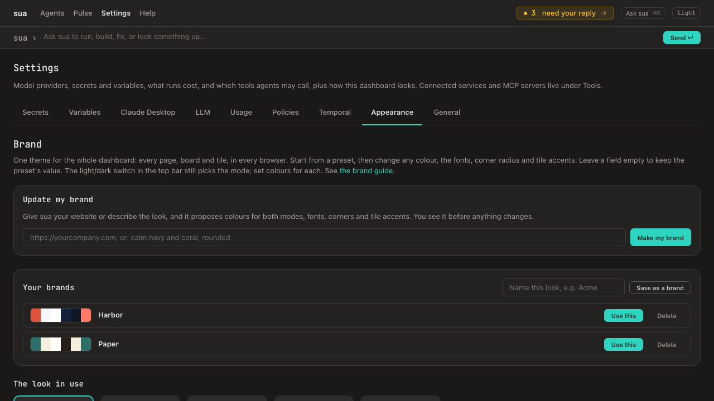

# Brand theme

One theme styles the whole dashboard: every page, every board, and every tile drawn inside a board, in every browser. Set it in **Settings → Appearance**. The page reads top to bottom:

- **The look now**: its name and two small dashboards drawn in its colours, light and dark. **Undo last change** puts the previous look back; **Reset to sua's default** clears it. **Save as a brand** keeps the look under a name.
- **Pick a look**: your saved brands, then the presets (*Default*, sua's own look; *Warm*, *Minimal*, *Neon*, *Editorial Paper*), each drawn in its own colours. **One click uses it** everywhere; Undo goes back. A preset is used as it is: your own colours on top of the old one go (Undo brings them back, or save the look as a brand first). (Presets used to be per-browser "widget themes"; they're now shared.)
- **Make one with sua**: paste your website or describe the look, and sua proposes one (see below).
- **Fine-tune** (folded until you open it): change the look you have. The previews at the top follow as you edit; nothing changes until **Save changes**.
  - **Colours**, per mode (the **Dark mode / Light mode** tabs): accent, background, cards and text, with a swatch to pick from and the value beside it; **More colours** has raised cards, borders, muted text, good, warning and error. An empty value keeps the preset's (shown in grey); **×** goes back to it. Shades Fine-tune has no field for (a made brand's hover and soft colours) are kept when you save.
  - **Corners**: one slider from sharp to round (sets the small, medium and large radius together).
  - **Fonts**: the text font and the **heading font** (page titles, card titles and labels; sua's default is its code font, which is most of what makes a page look like sua), from a short list or **Custom…** (family names separated by commas); the code font is under **More**. Use fonts the viewer's computer has (the dashboard loads no web fonts besides its code font).
  - **Tile accents**: the six colours a tile's accent edge can be (teal, blue, green, orange, red, purple). The accent tile palettes (accent-teal, accent-red, accent-green) tint from these too.

Colours can be `#rrggbb` (or `#rgb`, `#rrggbbaa`), `rgb(…)`, `rgba(…)`, `hsl(…)`, `hsla(…)` or `transparent`. Anything else is refused, so a theme can't break the page's styles.

Every change applies everywhere at once. A save from a page that's out of date (someone else changed the theme meanwhile) is refused rather than overwriting their change.

## Your brands



Keep more than one look and switch between them. At the top of **Settings → Appearance → Brand**, **Your brands** lists the ones you've saved, each with a strip of its colours:
- **Save as a brand** keeps the look in use under a name (saving with a name you've used replaces that brand).
- **Use this** makes a saved brand the look everywhere. The previous look stays one **Undo last change** away.
- **Delete** removes a saved brand; the look in use doesn't change.
- **In use** marks the brand whose colours, fonts, radius and accents match the look in use.

Saved brands are theme files in `.sua/brands/<name>.json`, checked like the active theme (one that doesn't validate is skipped).
## Update my brand (sua makes one)

At the top of **Settings → Appearance → Brand**, give sua your website (`https://yourcompany.com`) or a few words (`calm navy and coral, rounded`) and choose **Make my brand**. The `brand-maker` agent proposes colours for both modes, a font stack, corner radius and tile accents, and says where the look came from. A website is fetched and read; if its styles can't be read, the note says so.

- **Preview first:** the proposal is drawn as a small light and dark page in its own colours. Nothing changes until you choose **Use this brand**, which puts it in use and saves it under **Your brands** (so you can switch back to it, or delete it); **Discard** drops it, and **Try again** asks again.
- **Checked:** the proposal must pass the same checks as a hand-made theme (a font family that doesn't is dropped, not the whole brand). sua also measures contrast and lists anything hard to read: text on the page and on cards needs 4.5:1, muted text and the accent need 3:1.
- **Undo:** using it is an ordinary save, so **Undo last change** brings the previous look back.

The proposal waits in `.sua/brand-proposal.json`, one at a time.

## How it works

The theme is stored at `.sua/theme.json` in your data directory and served as `/assets/theme.css`, a set of CSS custom properties (`--color-primary`, `--font-sans`, `--radius-md`, `--accent-teal`, …) on top of the design tokens. Every stylesheet and every A2UI component reads those tokens, and they reach inside each board tile, so nothing needs to know about the theme itself.

```json
{
  "version": 1,
  "name": "Acme",
  "preset": "warm",
  "dark": { "primary": "#ec4899" },
  "light": { "primary": "#be185d" },
  "fonts": { "sans": "\"Inter\", system-ui, sans-serif", "display": "\"Inter Display\", \"Inter\", system-ui, sans-serif" },
  "radius": { "md": 8 },
  "accents": { "teal": "#14b8a6" }
}
```

You can edit the file directly; the next page load uses it. A file that doesn't validate is ignored (the default theme applies) rather than breaking the dashboard. The file also covers colours the form doesn't show (`text-subtle`, `primary-hover`, `primary-soft`, `ok-soft`, `warn-soft`, `err-soft`, `info`, `info-soft`).

## Agents and the brand

Agents style through names, never colours: tones (`neutral`, `ok`, `warn`, `err`) on Metric and Badge, tile palettes and accents by name, and no colours or inline styles in agent-written HTML. `board-read` ends with this guide, so an agent arranging a board sees it, and whatever it builds follows the theme.

## Limits

- Older widgets that set their own colours in their HTML (some `ai-template` widgets) keep those colours.
- One look in use per dashboard at a time (switch between saved brands); a theme per board may follow.

## Related
- [Boards](boards.md) — the canvases the theme styles
- [Dashboard](dashboard.md) — Settings → Appearance
