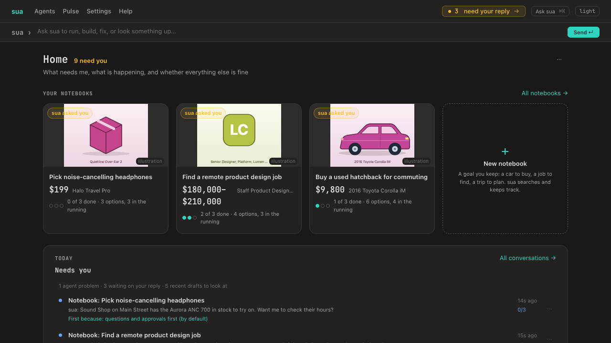
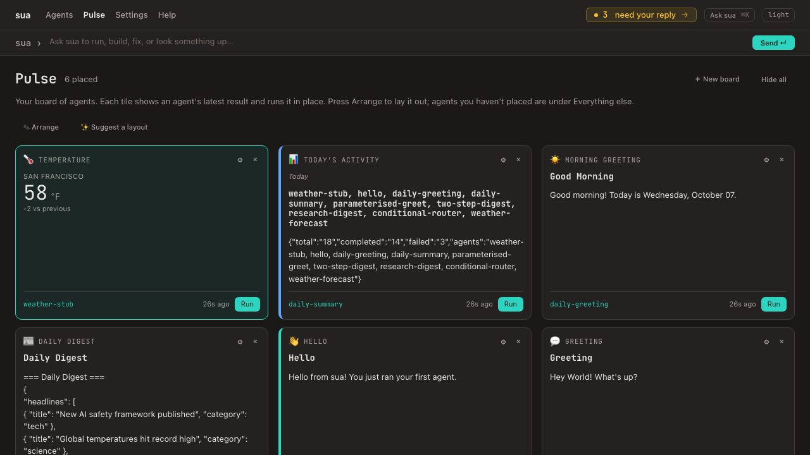

# Dashboard tour

Every page, what it's for, when to use it.

Start the dashboard with `sua dashboard start`. The first startup prints a one-time sign-in URL with the bearer token in the fragment (e.g. `http://127.0.0.1:3000/auth#token=…`). Click it once; the dashboard stores an HttpOnly cookie and you bookmark `http://127.0.0.1:3000/`.

### Staying signed in

The session is an **idle** window — it renews on every page you load, so using
the dashboard keeps you signed in. The default is 30 days of inactivity; set
`SUA_DASHBOARD_SESSION_HOURS` to change it. Details and the security rationale
are in [SECURITY.md § Dashboard session lifetime](SECURITY.md) and
[ADR-0033](adr/0033-idle-dashboard-session.md).

If a session does lapse, the page says so and the tab shows a "You have been
signed out" banner rather than quietly failing. To sign in again you need a
fresh link, because `sua dashboard start` prints one only at boot:

```bash
sua dashboard signin-url
```

Run it on the machine hosting the dashboard and open the link it prints. That
link carries the bearer token, so treat it like a password — and note that
`sua mcp rotate-token` invalidates every existing session immediately.

Dark mode by default. JetBrains Mono. The design system source-of-truth is [DESIGN.md](../DESIGN.md).

The footer shows a **build stamp** (`sua vX · <sha>`) so you can tell which build the running daemon is serving; `-dirty` means uncommitted changes were in the build tree. The same stamp is exposed at `GET /health` as `{ commit, builtAt }`, alongside `runs_last_hour`, the scheduler's heartbeat, and `reaper`: what the boot reaper and the stuck-run watchdog have cleaned up since the dashboard started (counts only). See [Build from a goal § Build stamp](build-from-goal.md#build-stamp).

## Navigation

The top bar: `sua · Agents · Pulse · Settings · Help`. The `sua` brand is Home, which is your inbox (`/`). **Agents** groups the building blocks; its pages share an in-page tab strip (**Start here · Agents · Behaviors · Tools · Runs · Packs · Scheduled**) under the page header. An amber **"N need your reply →"** toast in the top bar (every page) appears when inbox threads are waiting for you. The **Ask sua** bar under the top bar starts a conversation with the triage agent from anywhere.

### The conversation panel

Asking sua opens the answer in a panel beside the page, not over it, so you can keep looking at the tile or run you're asking about. **Ask sua** in the top bar, or **Cmd/Ctrl+K**, opens the panel (your last thread, or a box to start a new one) and closes it again. The panel stays open as you move between pages, per browser tab.

- With no thread open, the panel is your inbox. One field searches as you type and asks sua when you press Enter. Below it, **Today · Open · Chats · Done** (with counts) and your threads, 25 at a time: on Today grouped into **Waiting on you** and **Keeps failing**, elsewhere into Today / This week / Earlier. Each row has a dot and a one-word tag for what it needs (**Approve**, **Answer**, **Failing**). It opens on Today when something is waiting. Pick a thread to read and reply in the panel; **← Inbox** goes back to the list where you left it. The list updates as threads change.
- **+** starts a new conversation: a box to ask sua and a few starting points.
- A conversation shows its title on one line, then its state (Your turn, sua replied, Resolved…), who it's with and how old it is. **⋯** holds Star, Tags, **Ask sua to look again**, Summarize, Resolve / Dismiss / Reopen and **Open full page**. Messages show who said them (You, sua, the agent); status notes are quieter. Proposed actions are cards that say what they'll do and whether they only read or change something, with the inputs under **Details** and **Run it** / **Not now** (or **Apply fix**, with the changes to the agent folded under "+N −M"). **↻** beside the search reloads the list, which otherwise updates by itself.
- **↗** opens the thread in the inbox; **⤢** widens the panel and **⤡** puts it back; **–** minimizes it to a pill in the corner, which lights up when a reply lands.
- On wide screens the page makes room for the panel; on narrower ones it slides over the page; on a phone it fills the screen. **Esc** closes it while you're in it.

On Home the same inbox fills the page instead (below), so it's one inbox at two widths.

## `/` — Home



Home is what needs you, on one page:
- **The header** says how things stand ("2 need you", or "Nothing needs you") beside the title, with a **⋯** menu. The menu holds **Autonomy** (Full / Approve first / Off), **Adjust Home** (ask sua to change what Home shows, and **What changed**), and **Open the full inbox**.
- **Your notebooks**: a card for each active notebook (the four changed most recently; **All notebooks** for the rest) with its picture, the best option so far and its price, its done-when criteria as dots, how many options are in the running, and **sua asked you** when sua is waiting on your reply there. Then **+ New notebook**. On a phone the cards are a row you swipe.
- **Today** fills the page: drawn from Home's surface (what needs you, what's happening, and whether everything else is fine) and ordered by your rules. See [surfaces](surfaces.md#homes-today-tab). Clicking a row opens it in the sua panel beside the page: a conversation as its thread, anything else (a failing agent, a draft) with its actions and why it's there. Row menus (pin, move, hide, dismiss) work here as in the panel. Today redraws itself as things change.
- **Ask sua** in the bar at the top; there's no second ask box on Home.

With no agents installed, Home is the Build-from-goal empty state instead. The board of agent tiles lives on [Pulse](#pulse--the-board), and run activity on [`/runs`](#runs--runs-list).

## `/inbox` — the full inbox

Every conversation on one canvas: the list on the left (ask box, **Today · Open · Chats · Done**, search), the open thread on the right with its conversation, action cards and inline widgets. Replies stream in over the chat WebSocket. `/inbox/:id` opens it with that thread selected; picking a thread updates the address. On a narrow screen you see the list or the thread, with **← Inbox** to go back. It's the same inbox the conversation panel shows beside other pages.

The list here also has **Filter and sort** (where a thread came from, its agent, a tag, starred only; sort by latest activity, oldest first or priority; every tab's count follows the filters), a ★ on each thread, and checkboxes: select threads, or all on the page, then **Resolve** or **Dismiss** them together. Starred threads lead whatever sort you pick.

## `/agents` — Agents list

**Tabs:** User / Examples / Community (with per-tab counts). Community hidden unless you have community agents imported.

**What do you want to do?** — the box at the top. Say it in your own words ("find startups hiring in fintech"):
- **Keyword matches** show at once, from the same ranker sua uses to pick agents in a conversation.
- **sua's picks.** sua's agent finder (`agent-catalog-search`, the one it runs in a conversation) looks at every agent. Its picks appear above the matches: its recommendation, then up to three agents, each with why it fits, a question you can ask it, and **Run**.
- **When nothing fits,** **Ask sua to build one** puts the request in the sua band.
- **Talk it through with sua →** is on every answer. It opens a conversation whose first message is your question and what the finder suggested (each pick with why). sua carries on from there: it can compare them, change one, or build a new one without searching again. The search itself never opens a conversation; it's a run of `agent-catalog-search` you'll see under Runs.
- **Repeat questions** asked within the hour are answered from the same search. Without `agent-catalog-search` installed, only the keyword matches show.

**Browsing** (the User tab, nothing filtered) shows shelves:
- **Your go-to:** starred agents, then the ones you've run most this month.
- **Used lately:** the last week.
- **Fill notebooks.**
- **On a schedule.**
- **By what they do:** a shelf per group sua sorted your agents into ("Jobs & companies", "News & digests", "Fun"…), biggest first, its three most-used agents as cards and **All N →** for the rest (`?group=`, one line each, most used first). Agents sua hasn't sorted yet wait under **Not sorted yet**.
- **All agents:** every agent as one line, by name.
- **Folded away at the bottom:** demos, tests and drafts you've never run (names like `smoke`, `demo`, `test`, `probe`, `hello`, or ones sua put in "Demos & tests"; a starred one stays out).

**How sua sorts them.** The `agent-catalog-sorter` system agent (installed by the dashboard at startup) reads each agent's name, description, tags and sample questions, puts it in one group (reusing the groups already in use, at most 12) and writes one plain line on what to use it for ("Find open roles at a company on Ashby"). That line replaces the description on cards and rows (the description stays as the hover text), and the **What do you want to do?** box searches it too. Sorting runs in the background when the page opens and some agent is new or changed (its name, description, tags, questions or version), 40 agents per run; the page says "sua is sorting your agents…" and reloads once when it's done. An agent it couldn't place is tried again after 10 minutes. The groups live in the `agent_catalog` table; sorting never changes an agent's version.

**Cards** are slim:
- the name (with the id beneath when the name doesn't just restate it), a two-line "use it for" line (sua's, or the description until it's sorted) and one question you can ask it;
- chips for anything worth knowing: not active, feeds N notebooks, calls N, used by N, its schedule, mcp;
- when you last used it ("used 1d ago · 26 runs this month"), and **Run**.

How an agent is built (its nodes and DAG) is on its own page.

**Filters** — folded under **Filters** (open while one is on): status (active/paused/draft/archived) and sort (name / status / recently run / starred first). Any filter, a search, or the Examples tab shows a paged list of cards (12/24/48/100) instead of shelves. The **Calls other agents** and **Feeds notebooks** chips stay on as you page or switch tabs.

**Fixing an agent that isn't working.** **Ask sua to fix this** on an agent's page opens a conversation in the panel where sua first asks what's going wrong. Tell it what you saw, or press **Look at its recent runs**; either way sua drafts a fix and shows it as a diff you **Apply** or skip. Nothing changes until you do. The same happens on its own when an agent's failure thread reaches three failures (once per thread; not while autonomy is Off or the thread is paused). An applied fix is a new version under the same id, so boards, schedules and history keep pointing at the agent and **Versions** can roll it back. A fix changes what the agent does, never whether or when it runs: its status always stays, and its schedule stays unless the fix sets one. If the agent changed after the fix was drafted, applying it is refused and you can ask sua to look again. If three fixes to one agent go by in a conversation without a successful run, sua stops fixing it on its own and asks you what to try next. Your answer lets it continue, and so does any successful run of the agent in that conversation; after that, further changes are new work, not another round of the same fix.

**Archived agents** are left out of the list unless you filter for them; **Archived (n)** beside the filters shows them. To archive an agent, set its status to `archived` from the status menu on its page. An archived agent doesn't run on its schedule or by hand (Run now and tile runs say to restore it first), can't be called by other agents, and leaves Pulse, the tile picker and sua's suggestions; a board that already places it keeps the tile, marked **archived**, without a Run button. Its page says so and has **Restore**, which brings it back active, or paused if it has a schedule, so nothing fires until you resume it. Runs and versions are kept throughout.

**Calls other agents (N)** — a chip beside the filters narrows the list to agents that run other agents as part of their job. The count is scoped to the current tab and search, so it predicts what clicking returns. Agents calling agents is the multi-agent story: sua ships `agent-invoke` and `loop`-over-agent node types, and its own Build-from-goal is one of these — `goal-surveyor` → parallel `agent-drafter`s → `dashboard-designer`.

**Build from goal** — describe what you want in plain English; an orchestrator runs goal-surveyor → agent-drafter(s) → dashboard-designer to design the full YAML and tiles. Opens a modal. See [Build from a goal](build-from-goal.md).

**New agent** — interactive scaffolder at `/agents/new`.

## `/scheduled` — Scheduled agents

Sibling tab in the Agents strip (Start here · Agents · Behaviors · Tools · Runs · Packs · **Scheduled**). Lists every agent with a `schedule:` field — regardless of status — so paused-but-scheduled and draft-with-cron agents are visible alongside active ones. Sorted by next-fire (earliest first), with id as the tiebreaker.

**Columns:** Agent (id + truncated description) · Status (badge) · Schedule (humanized cron, raw on hover) · Last fire · Next fire · Actions.

**Per-row actions:**

| Row status | Button | What it does |
|---|---|---|
| `active` | **Pause** | Sets status=`paused`. Cron stays declared so Resume restores firing one click later. Reversible. |
| `paused` | **Resume** | Sets status=`active`. Scheduler starts firing the next cron tick. |
| `draft` | **Activate** | Sets status=`active`. First-time activation for an agent that was authored but never turned on. Same semantic as Resume but different copy ("Activated" vs "Resumed"). |
| `archived` | — | No row action. Use Edit. |

Every row also has **Clear**, which removes the schedule (the agent stays and runs when asked; it asks first, in the page, since the cron is gone afterwards), and an **Edit** link to `/agents/:id/config` for cron changes. The scheduler drops a cleared schedule when it restarts.

**Inline hints in the Next fire column** (the page reads as transparently as possible):

- `active` → formatted relative time (`9h`, `2d`).
- `draft` → `won't fire — status is draft` (cursor-help; tooltip explains the active-only rule).
- `archived` → `won't fire — archived`.
- `paused` → `—` (cron paused-by-intent; Resume restores).

**`never` in Last fire** has a tooltip clarifying that the column counts only `triggeredBy='schedule'` runs — manual runs via dashboard / CLI / MCP don't count here. An agent run manually but never by the scheduler shows `never` by design.


## `/agents/:id` — Agent detail

Six tabs:

### Overview
The page leads with what the agent makes. The header has **Ask sua** (say what's wrong or what to change; sua drafts a fix you approve), a **⋯** menu (Suggest improvements, Redesign how results look, Edit the view, Versions, YAML) and **Run now**; a long description shows two lines with **more**.

- **Latest result** — the last finished run, drawn the way the run page draws it (the agent's view, else its output widget, else the text; when none of a widget's fields are in the output, the text), with when it finished, how long it took, a link to the run and **✎ Change how this looks** (straight to Redesign on the View page). A run in progress says so.
  - **When the newest run failed,** a red card says so with its first error line, **Open the run →** and **Ask sua to fix it**. The section is then titled **Last good result**, showing what the agent made the last time it finished.
  - **Output with no widget or view** that is one JSON object shows as labelled facts (an empty one says "(empty)"), and a JSON list of records shows as a table. The raw text stays under **Raw output**.
  - **An agent other agents or notebooks call** (often one item per run) also lists **Its last N results**: when, the run's input (a link first) and the answer in a line, such as "status: blocked". The list is open when the latest result is a short JSON answer, since one result alone says little.
  - **Run with different inputs** opens the inputs form right there (open already when it has never run).
- **At a glance** (beside it; below it on a phone) — the last runs as dots, oldest to newest, each linked, with how many finished; version, model, when it runs, how results look (with **edit**), whether AI apps can call it, spend over 7 days and limits, behaviors it's held to, its tools; then **Called by** (with a reminder that a change here changes what they get), **Calls** (the node that calls, "once per item" for a loop, "as a tool when the model decides to"; a target chosen at run time says so, a missing one is badged) and **Fills notebooks** (each with how it was made). Agents are tagged `draft` / `paused` when they won't run on their own and `helper` when built as one.
- **How it works** — the steps in order, each linked to its editor, and **Show the diagram** (also open on the **Nodes** tab): the Cytoscape canvas (wheel-zoom, drag-pan, **+ ⧇ −**; click a node for Edit, Replay from here, Jump to details; a step that calls another agent names it on a second line). **Edit wiring** turns it into a wiring editor: drag one node onto another to make the second depend on the first (or click source then target), click an edge to remove it, and **Save wiring** writes every change as one new version. Cycles are refused, and so is cutting an edge whose downstream still reads `{{upstream.x.result}}` or `$UPSTREAM_X_RESULT`; cutting one an `onlyIf` still names saves with a warning. While a run is in progress, the diagram opens on its own, the running step pulses (as on the run page) and steps that haven't started are grey with a dashed edge, the heading says which step is working, and the page reloads when the run ends so Latest result shows it. A single-goal agent shows its goal, tools and budget here instead.
- **Memory** — for agents with `memory:` on.
- **When to use it** — collapsed: what you can ask it (chips that fill the sua bar), when to use it and when not to.
- **Danger zone** — delete, after typing the agent's id.

On the agents list, a **feeds N notebooks** badge marks agents that fill notebooks, and the **Feeds notebooks** chip narrows the list to them.

### Chat
Talk to the agent. Each message is a run (linked under the reply), and the agent sees the conversation so far. Replies stream in as they're written (with Claude), with the tools the agent calls shown as it calls them; an agent with an A2UI `view:` replies with its widget, and clicking a button in it sends the next message. Conversations are listed on the left; open one to continue it, or delete it (its runs are kept). An agent without a text input for the message says so and points at the YAML tab. See [conversations.md](conversations.md).

### Nodes
The canvas first (the same one as the Overview's **Show the diagram**: click a node for its actions, **Edit wiring** to rearrange; saving from here comes back here), then the steps as a table. Edit / delete / add nodes inline. Template palette autocomplete for upstream fields + inputs + vars. Per-node timeout, env, secrets, onlyIf predicates. **Goal nodes** are added and edited here too (goal, tools, budget); llm and goal nodes pick the tools their model may call from a searchable checklist that shows policy blocks. See [goal-agents.md](goal-agents.md#editing-in-the-dashboard).

### Settings
One page, with a section menu on the left. Each section has a one-line summary of where things stand:

- **Inputs**: what you can pass when it runs. **Edit inputs** opens the editor (name, type, default, description; enum types get a values column).
- **Model**: the provider and model every prompt step uses. A step can still pick its own model in the YAML.
- **When it runs**: preset chips (Only when asked, Hourly, Daily 8am, Weekdays 9am, Mondays 9am), or a custom five-field schedule; a time limit for a whole run (**Stop a run after**, in minutes; the agent's `timeoutSec`); whether runs are durable (Temporal).
- **Where it shows**: Pulse, the agents list, AI apps (MCP); the output widget (see [Output widget editor](#output-widget-editor)) and the view, edited with a live preview (see [The View editor](a2ui-views.md#the-view-editor)).
- **Connections**: the inbound webhook and notify-when-finished.
- **Access**: whether sua can run it from a conversation, which hosts its widgets may load images from, which agents it can hand work to, and its secrets.

Model, When it runs, Where it shows, and the first two Access settings save together. As you change them, the changed sections are marked, and a bar at the bottom says how many changes are unsaved, with **Discard**, **Review** (each change as before → after) and **Save**. Saving applies them all at once; if any changes what the agent does, they become one new version (**Save as vN**), which you can roll back from Versions. After a rollback, the next version is numbered after the newest one (roll v9 back to v8, and the next save is v10), so no version is overwritten. A new schedule takes effect when the scheduler restarts (`sua daemon restart --service schedule`). Inputs, the webhook, notify and hand-off agents save on their own, and their sections say so.

**Ask sua to change this agent** (top of Settings) opens a conversation in the panel with what you typed. sua answers with a **Change N settings** card that lists each change as before → after. **Apply** saves them the same way Save does (one new version if any change affects what the agent does). **Not now** skips it, and **Open in Settings** jumps back to the page. sua can propose the same card in any conversation about an agent ("run it weekdays at 9 and let Claude Desktop call it").

### Runs
Paginated run history. Filter by status. Click any row for per-node stdout/exit codes/errors. "Replay from node" button re-runs starting at any node, reusing upstream outputs and the original run's inputs.

### YAML
Editor for the raw YAML. Zod validation on save. Versioned — each save creates a new `agent_versions` row.

## Output widget editor

At `/agents/<id>/output-widget` (linked from the agent's **Settings** tab, under *Where it shows*). The core loop:

1. **Pick a card** — 5 widget types (raw / key-value / diff-apply / dashboard / ai-template). Each card shows an ASCII layout hint and a one-line description.
2. **Read the helper** — a paragraph under the picker explains which field types work for the selected widget and how field names are matched against the run output.
3. **Declare fields** — name, optional label, type. The type dropdown shows tooltips on hover; types incompatible with the selected widget are dimmed with `(n/a)`.
4. **Or load an example** — 5 one-click starters (Report card, Metric dashboard, File preview, Diff applier, Key-value summary).
5. **Or use AI** — pick `ai-template`, write a prompt, click Generate. A modal with a spinner + elapsed-seconds counter + Cancel button shows progress. Sanitized HTML appears in an editable textarea.
6. **Preview** — live preview card rerenders as you edit (debounced 200ms).
7. **Save** — persists to the agent's DB row.

See [Output widgets](output-widgets.md) for the full reference.

## `/tools` — Tools list

**Tabs:** Imported / Built-in / Servers / Integrations (with counts). Tools is the one home for everything an agent can call.

- **Imported** — tools imported from MCP servers or authored locally.
- **Built-in** — the tools that ship with the runtime (plus tools generated by integrations).
- **Servers** — imported MCP servers with tool counts, **Enable/Disable** (gates every tool from that server) and **Delete** (cascades). See [MCP servers](mcp.md).
- **Integrations** — saved connections: notify destinations (Slack / webhook / file) and data-source / service kinds — CSV / Postgres / SQLite (which generate find/count tools) and Gmail (OAuth). See [Integrations](integrations.md).

Each card shows tool id, source badge (local / examples / community / builtin), implementation type badge (shell / llm-prompt / builtin / mcp), description, input + output counts.

**Import from MCP server** CTA in the page header → `/tools/mcp/import`.

See [Tools](tools.md) for the full catalog.

## `/tools/:id` — Tool detail

Read-only reference: inputs + outputs tables, implementation details (command, prompt, builtinName, or MCP transport+command+toolName). For MCP tools, links back to `/tools?tab=servers` for the source server.

## `/tools/mcp/import` — MCP import

Two paths on one page:

- **Quick add by URL** — for HTTP MCP servers. Name + URL. One click.
- **Paste full config** — Claude-Desktop / Cursor `mcpServers` map, bare map, or single-server shape. Accepts JSON or YAML.

Click Discover → server opens, lists tools in parallel, you pick which to import, click Create. See [MCP servers](mcp.md) for the full flow.

## `/runs` — Runs list

Every run across all agents. Filter by agent, status (pending / running / completed / failed / cancelled). Paginated. Click a row for run detail.

## `/runs/:id` — Run detail

Per-node execution table with stdout, exit codes, errors, timings. For `llm-prompt` nodes, real-time turn progress via stream-json, and a **tool calls** list: every tool the model called during the node, whichever provider it ran on (`native` marks a provider's own tool, e.g. claude's WebFetch), each expandable to its arguments and result. Runs from before this was recorded fall back to the tool events in the progress stream. "Replay from node" button on each row. The **Node execution** header (title + search input + status-filter dropdown) sticks at `top: 0` while node cards scroll under it; an rAF-throttled scroll observer releases the DAG/Result sticky bar above it back to `position: static` when this header reaches the release line, so the two sticky surfaces don't fight for the top of the viewport.

**Waiting.** A run stopped at an `ask` node shows *waiting* and a banner with the question, an **Answer** button (to its inbox item) and **Cancel run**. See [ask-a-person.md](ask-a-person.md).

**Budgets.** Goal and llm nodes show turns, tool calls and time used against their budget; an out-of-budget node says which limit it hit and links to the fix. **Sub-runs** (agents a run called) are indented as a tree.

**Cost.** The run's cost (USD at list price, including agents it called) and tokens appear in the header, and each llm node carries a cost chip whose hover lists every provider attempt. See [cost.md](cost.md).

Resolved variables panel shows what values the run actually saw (inputs after defaults, vars after substitution).

**Cancel + abandoned errors.** A **Cancel** button appears while the run is `running` or `pending`. The cancel route SIGTERMs the spawned child and escalates to SIGKILL after 5s if the child hasn't exited, then finalizes both the run row and any still-`running` `node_executions` rows to `cancelled` with a flash banner. A separate `errorCategory: 'abandoned'` appears on rows the orphan reaper finalized on a later dashboard boot (i.e. a daemon restart killed the parent process mid-run); the run-level error names the cause inline. See [Security model § Orphan process reaper](SECURITY.md) for the mechanism.

## `/pulse` — the board



Pulse is a [board](boards.md), drawn as one A2UI canvas: arrange it with **✎ Arrange** (sections, grids, tabs, rows, cards) or **✨ Suggest a layout**, or build a new board from a description with **＋ New board**; agents you haven't placed are under **Everything else**, grouped as described next.

The board is your agents at a glance. Each agent with a `signal:` block, or an A2UI `view:`, gets a tile showing its latest result, and every tile has a **Run** button. Tiles are drawn with [A2UI](a2ui-views.md) (sorting, filtering, tabs and run-in-place forms work in the browser).

**13 templates:** `metric`, `time-series`, `text-headline`, `text-image`, `image`, `table`, `status`, `media`, `widget`, `comparison`, `key-value`, `story`, `funnel`.

**`template: widget`** is special — mirrors the agent's own outputWidget. No mapping required.

**Everything else groups tiles by how recently you used them** — Health (system metrics),
Recent (ran in the last 7 days, newest first), Idle, and Never run. Empty groups
are omitted. The ordering is meant for a run console: what you used last is what
you are most likely to run again, and agents you set up but never used are
collected at the bottom rather than scattered through the board.

Configure tiles via the ⚙ gear on each one, and set a tile's palette in **✎ Arrange**. Hide/unhide via the × (it toggles the agent's `pulseVisible` flag). System tiles (runs today, avg duration, failure rate, agent count, **scheduler**) head the tray until you place them.

**The scheduler tile** reports whether the schedule daemon is actually running,
because a dead scheduler is otherwise invisible here: `/health` knows and
`/scheduled` says so in its header, but that is the page you only open once you
already suspect something. Red means agents are scheduled and nothing will fire
them — the case that costs you runs. Amber covers the merely odd: the daemon off
with nothing scheduled, or alive but registered nothing (which is worse than
being visibly off — it reads as fine and never fires). `sua doctor` reports the
same state and exits non-zero on the red case.

**Every tile is runnable.** Each tile carries a **Run** button in its footer that
re-runs the agent and refreshes the tile in place — no navigation to the run
detail page. This includes tiles that have never run, which is the point: a tile
you set up but never used is the most useful thing on the board to be able to
start. Tiles whose body already offers a run control keep theirs instead — an
interactive widget's mini-app, or a widget tile's **Run again** — so no tile has
two. System metric tiles have none; there is no agent behind them.

An agent with a *required* input and no default shows **Run…**, linking to the
agent page where the full run form lives, rather than a one-click button that
would fail every time.

Without JavaScript the button still POSTs to `/agents/:id/run` and navigates to
the run, as before.

**Tiles run themselves.** Adding an agent to a dashboard runs it once automatically, so a freshly added tile is never blank. If a widget references an external image host blocked by the dashboard's CSP, the tile shows a one-click **allow** modal that appends the host to the agent's `permissions.imgSrc` allowlist.

**✨ Suggest a layout** — on Pulse and any named dashboard. The layout planner proposes an arrangement that opens in the editor for you to adjust and save.

**Dashboards dropdown** — in the board header; switches between the default board and any named dashboard, with a "New dashboard name" field to create one inline. Long names truncate with a tooltip. **+ Install from Packs** opens an in-place modal listing every registered-but-uninstalled pack with an Install button (you stay on the board), plus a "Browse all packs →" link to the full `/packs` page.

## `/dashboards/:id` — Named dashboards

Named views over installed agents — pack-owned (e.g. `starter:media`) or user-created — each a [board](boards.md): arrange it with **✎ Arrange** (which also adds agent tiles) and **✨ Suggest a layout**. Render at `/dashboards/:id`, edit inline at `/dashboards/:id/edit` (rename the dashboard, add / remove / reorder sections and tiles, all server-rendered). Renaming changes only the display name — the dashboard's stable id is preserved (shown in the editor header), so delete and pack uninstall still match after a rename. The built-in "Default Dashboard" (Pulse) has no stored row and can't be renamed. The **+ Add tile** modal is in-place and offers a blank agent or build-from-goal; edit mode persists across reloads and warns before you navigate away. Pack-owned dashboards are editable but not deletable (uninstall the pack) — their editor explains why and links to the owning pack's page, where Uninstall removes the pack's dashboards while keeping any contributed agents; user-created ones are deletable, and removing the last tile offers to delete the dashboard. Each named dashboard curates its own tile list independently of `pulseVisible`. The same tile behaviors as Pulse apply (first-run auto-execution, in-place Run again, CSP image-allow).

## `/boards/:id` — Boards

Redirects to the board's page (`/pulse` or `/dashboards/<id>`). `/boards/<id>/canvas` redirects the same way. `/boards/<id>.json` returns the board's layout. See [Boards](boards.md).

## `/settings`

**Appearance → Brand** sets one theme for the whole dashboard (preset, colours for dark and light mode, fonts, corner radius, tile accents). See [Brand theme](brand.md).

Tabs: Secrets, Variables, Claude Desktop, LLM, Usage, Policies, Temporal, Appearance, General. (MCP servers and integrations live under [Tools](#tools--tools-list).)

### Secrets
Encrypted-at-rest store (scrypt + AES-256-GCM). Unlock with passphrase, set/delete secrets, copy-before-save modal for newly created secrets.

### Variables
Global plain-text values. CRUD with values visible. Referenced as `$NAME` / `{{vars.NAME}}`.

### Claude Desktop
sua as an MCP server for Claude Desktop and other clients: the config to paste, and token rotation. See [MCP](mcp.md).

### LLM
The provider waterfall: reorder and enable/disable providers (add an OpenAI-compatible endpoint with **Connect a model**). Codex and Claude each have a **Model** line listing what that CLI offers your account now; a retired model in use gets a System health thread. See [LLM providers](llm-providers.md#the-codex-and-claude-models).

### LLM → Pricing
Prices (USD per million tokens) for providers that report tokens but not cost (codex, OpenAI-compatible endpoints), per provider or per `provider/model`. See [cost.md](cost.md).

### Usage
What runs cost over the last 1 / 7 / 30 days, by agent and by provider/model, with a note when some tokens had no price, and the default **spend limits** (per run, per agent per day) for agents without their own. See [cost.md](cost.md).

### Policies
The tool policy: the rules in order ("the last match decides"), add / edit / reorder / delete, the default action, **Edit as JSON**, **Undo last change**, and **Would this be allowed?** to test a call. An invalid file is flagged in red (it blocks every tool call) and can be fixed here. See [tool-policies.md](tool-policies.md).

### Temporal
Connection status for the durable backend. See [Temporal](temporal.md).

### Appearance
The **Brand** theme (a preset, then your colours, fonts, corner radius and tile accents, for everyone; see [Brand theme](brand.md)); widgets and boards are drawn with [A2UI](a2ui-views.md).

### General
Data paths, retention, scheduler heartbeat.

## `/help`

A short tour, the CLI grouped by purpose (each command links to where the same thing lives in the dashboard), and links to the user guides on GitHub.

## `/help/tutorial`

8-step progress-tracked walkthrough. Scaffolds a hello agent, runs it, adds a second node, explores secrets, etc. Progress reflects your actual project state.

## Related

- [Quickstart](quickstart.md) — first-touch walkthrough
- [Build from a goal](build-from-goal.md) — Build + Improve-layout wizards
- [Agents reference](agents.md) — every YAML field
- [Output widgets](output-widgets.md) — widget types + AI templates
- [MCP servers](mcp.md) — import + lifecycle
