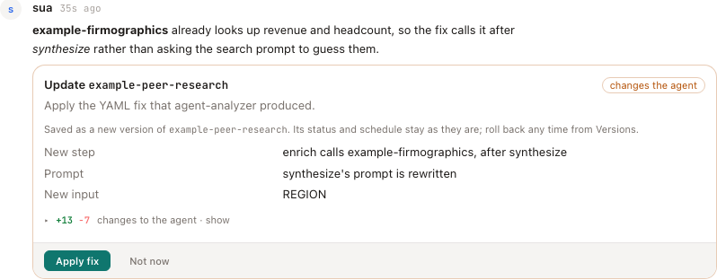
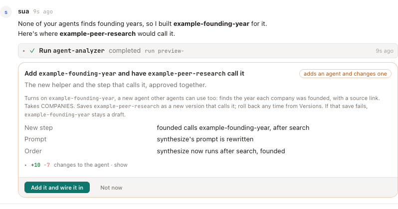

# Inbox control-plane plan

Turn `/inbox` from a notification queue into the operator surface for creating, testing, fixing, and orchestrating agents.

This document is the implementation plan for that shift. It is intentionally concrete: each phase should be shippable on its own, with visible operator value at the end of the phase.

> **Update:** the dashboard front door is now unified — the root `/` is one
> "Mission Control" surface that leads with a **Needs you** strip of inbox
> threads awaiting a reply, and a global **Inbox badge** (count from
> `/inbox/needs-you-count`) shows on every page. So the inbox is no longer a
> quiet nav link — it's surfaced at the front door. See
> [dashboard.md § `/` — Home](dashboard.md#--home).

## Current baseline

Today the inbox already supports the core primitives:

- threaded conversations with direct links at `/inbox/:id`
- triage replies plus proposed action cards
- direct-thread live updates
- inline action widgets for completed runs
- safe inbox-runnable agents via `permissions.inboxRunnable`
- draft install/apply actions after successful `agent-builder` runs
- bulk dismiss and stronger search on the list view

The autonomy loop (the "control plane" half) now runs by default:

- **Autonomous first-touch triage**: new non-`manual` items get a triage
  turn without an operator poke — an insert-time kick for latency plus a
  30s sweeper as the durable queue. Opt out with `SUA_INBOX_AUTO_TRIAGE=0`
  (or `experimental.inboxAutoTriage: false` in `sua.config.json`).
- **Local run failures raise items** (not just Temporal), coalesced per
  agent so a crash-looping agent is one thread with "another run failed"
  notes, not N threads. Opt out with `SUA_INBOX_LOCAL_RUN_FAILURES=0`.
  The stuck-run watchdog raises items for runs it reaps.
- **Durable follow-through**: a boot reconciler settles action cards
  stranded `running` by a restart against run-store truth, re-attaches
  waiters to in-flight Temporal runs, and re-fires triage once per thread
  whose turn died with the old process.
- **How far sua goes on its own**: after an action finishes, sua takes
  another turn to report or carry on. Between your replies it takes up to
  12 such turns and runs up to 24 actions, then pauses and asks you to
  reply. Your reply resets both. **Stop** halts it sooner, and repeated
  fixes to one agent without a good run end automatic fixing.
- **Bounded thread replay**: each triage turn (and the learning extractor)
  sees the thread as `[role] body` lines, most recent kept within 16 KB,
  with a note like "(49 earlier entries left out for length)" when a long
  thread is trimmed. The original ask stays in the prompt as the message
  body, and the operator's latest ask as the current request. Approved
  learnings are capped at 1.5 KB. Both use the same budget rule as agent
  conversations and memory recall (`core/src/transcript.ts`; see
  [conversations.md](conversations.md)).
- **A real Stop**: the operator Stop persists across restarts (`paused`
  column) and cancels in-flight sub-agent action runs, not just the next
  turn (Temporal cancels are best-effort — the worker may finish
  server-side).

The first `cadence` producer now ships: the **daily run digest**. Each
morning (local hour ≥ 8, previous calendar day) it posts one low-priority
`cadence` thread summarizing the day's runs — a counts header plus one line
per agent (a clean one-line summary for successes; a link to the existing
`run-failure` thread for failures, never restating the error). Internal
system agents (inbox-triage, agent-analyzer, …) and `_`-prefixed helpers are
excluded so the digest is about the operator's own agents. The per-agent
summary parses structured output (a final JSON object's `headline` / `summary`
/ `label:value`) rather than dumping raw JSON, falling back to the first
meaningful text line. Empty days
are skipped; one thread per day (`dedupeKey: cadence:daily-digest:<yyyy-mm-dd>`),
so it's restart-safe and catches up the previous day after downtime. It runs
in-process on the same `setInterval` + `unref` lifecycle as the auto-triage
sweeper (`packages/dashboard/src/lib/daily-digest.ts`), default-on with
`SUA_DAILY_DIGEST=0` to opt out. The `permission-request` producer remains
unbuilt (enum + playbook exist, no emitter yet — see Open questions).

A `system-health` source covers sua itself being down, which fails nothing and
so never opens a `run-failure` thread. Its first producer is the **scheduler-down
watcher** (`packages/dashboard/src/lib/scheduler-health-inbox.ts`): every minute
it reads the scheduler heartbeat and posts one high-priority thread when the
scheduler crashed — heartbeat file left behind, silent for 5+ minutes, pid dead,
and at least one agent scheduled — naming the agents that aren't firing and the
restart command. A clean `sua schedule stop` (heartbeat removed) and a sleeping
laptop (pid alive) stay quiet. One thread per crashed scheduler instance
(`dedupeKey: system-health:scheduler-down:<startedAt>`); it resolves itself with
a system note once a scheduler heartbeats again. `system-health` threads are never
auto-triaged — the message already says what to do.

- **Routing on agent metadata**: triage picks which agent to dispatch using each
  agent's routing metadata (see [Agents → Routing metadata](agents.md#routing-metadata--tags-entryconditions-nonentryconditions-samplequestions)).
  `entryConditions` and `sampleQuestions` boost an agent's relevance in the ranked
  `AGENT_CATALOG` (so it surfaces even when its name/description miss the request),
  and all three fields are handed to the triage LLM — which prefers agents whose
  entry conditions / sample questions match and treats `nonEntryConditions` as a
  veto. `nonEntryConditions` is never scored deterministically, so it can't drop a
  valid agent out of the catalog before the LLM sees it.

That is enough to prove the surface, but not enough to make inbox the default place to build and operate agents end to end.

## What "needs you" means

A thread waits on you (`awaiting_user`) only when it asks you something:

- a card to approve (one card names what it does; several are a choice: "Choose: Try again · Move on"),
- buttons in sua's last reply ("Pick one: Rule it out · Keep it"),
- a question near the end of sua's last reply,
- a note asking you to reply (sua paused, or crashed),
- or a failing agent.

A reply that only reports back ("Searched again: 5 new options") asks nothing, so the thread settles as answered (`triaged`). It stays in Open and Chats, but it's off Today and out of the count. The rule is `threadAsk` in core (`items/projections.ts`). The end of each sua turn, skipping a card, and a restart settle the status with it.

Each waiting row on Today says what it needs, in place of the start of sua's last message. A thread waiting on one card has that card's button and Not now on the row. To clear several at once, tick them on Home's Today (or any tab) and press **Close N** (done: they move to Done) or **Dismiss N** (off your list). A Today row that isn't a conversation, like a draft or an agent problem, is taken off Today the way its own Dismiss does, and comes back when something newer happens to it.

The top bar's "N need you" counts what Today lists as needing you, not counting drafts, so the number matches the page it opens.

## Product goal

Make inbox the place where an operator can:

1. ask for a new capability in plain language
2. receive a draft agent or workflow proposal
3. install or update that agent in-thread
4. run the agent with sample inputs
5. inspect the result inline
6. diagnose failures and apply minimal fixes
7. re-run and iterate
8. chain the result into another agent action when needed

The operator should not need to bounce between `/inbox`, `/agents`, `/runs`, and `/pulse` unless they deliberately want a deeper view.

## Phase 1: inbox list usability

Goal: make the queue easy to scan and clear.

Shipped baseline:

- better token-based search
- row selection + bulk dismiss

Remaining work:

- bulk resolve
- bulk star / unstar
- bulk add / remove tag
- stronger grouping for `Needs you`, `In progress`, `Drafts`, `Failures`
- saved filters or quick scopes for common queues
- clearer empty states and archive navigation

Success criteria:

- operators can clear low-value queue noise in a few clicks
- operators can reliably find an older thread by remembered phrase, tag, agent id, or partial thread id

## Phase 2: thread usability

Goal: make one thread a stable working surface, not just a transcript.

Build next:

- thread summary block for long conversations
- explicit thread actions:
  - fork to agent (built, then removed: it confused people)
  - retarget thread (built, then removed for the same reason)
  - reopen
  - summarize
- better distinction between:
  - triage prose
  - action cards
  - system notes
  - result widgets
- reduced duplicate narration when a widget or action card already shows the result clearly

Success criteria:

- a long thread remains understandable without reading every turn
- operators can move work to a more appropriate agent without losing provenance

## Phase 3: agent creation loop

Goal: make “build me an agent” complete end to end inside a single thread.

Required flow:

1. user asks for an agent in plain language
2. triage normalizes the ask into a builder-friendly spec
3. `agent-builder` drafts the YAML
4. inbox shows `Install draft` or `Apply draft`
5. install marks the new agent inbox-runnable when appropriate
6. triage can immediately run the new agent with sample inputs
7. results render inline as widgets
8. failure paths route into diagnosis and minimal fix proposals

Implementation notes:

- keep improving triage-side normalization for vague builder prompts
- preserve safe boundaries:
  - system agents can auto-run
  - user agents remain manual-run by default
- make failure messages specific enough to support the next action

Success criteria:

- a user can ask for a moderately simple agent in one sentence
- the agent can be drafted, installed, run, and iterated without leaving the thread

## Phase 4: safe multi-agent orchestration

Goal: let a thread coordinate several agents without becoming an unbounded executor.

Build next:

- reusable action types instead of only freeform triage prose:
  - build draft
  - install draft
  - run sample
  - analyze failure
  - apply fix
  - compare outputs
  - fork to agent
- richer allowlist context for triage so it knows:
  - which agents are runnable
  - which inputs they require
  - which agents are safe to auto-run
- stronger repeat-guard behavior:
  - block exact failed repeats
  - force an alternate next step or explicit out-of-thread fallback

Success criteria:

- operators can chain two to four concrete agent actions inside one thread
- the system avoids blind retry loops and unclear dead ends

## Phase 5: inline widgets as the working surface

Goal: make thread results feel like Pulse-quality outputs, not debug blobs.

Build next:

- prefer inline widget rendering over raw summaries whenever possible
- compact “action completed” chrome around the widget
- widget-first presentation for:
  - dashboards
  - key-value
  - raw
  - ai-template
- thread-aware result affordances:
  - rerun same inputs
  - run with edited inputs
  - compare to previous run
- keep interactive widgets read-only in-thread unless a reusable inline action model is introduced

Success criteria:

- a completed agent run in inbox reads like a useful result, not a log line
- operators can often make the next decision from the thread without opening `/runs/:id`

## Phase 6: orchestration beyond one agent

Goal: let inbox manage a working set of agents, not only individual runs.

Longer-horizon additions:

- thread-level “working agents” panel
- relationship view:
  - built by this thread
  - updated by this thread
  - invoked in this thread
- “use this output in another agent” affordance
- lightweight playbook threads for repeated operating routines

Success criteria:

- inbox becomes the control plane for agent operations, not just a triage queue

## Prioritization

Recommended order:

1. Phase 1 remaining bulk actions
2. Phase 2 thread usability
3. Phase 3 agent creation loop
4. Phase 5 widget-first result surface
5. Phase 4 richer orchestration primitives
6. Phase 6 working-set / playbook ideas

Why this order:

- queue hygiene and thread clarity remove the most friction fastest
- the agent creation loop is the highest-leverage end-to-end story
- richer orchestration is only worth it once thread results and thread movement are easy to follow

## Open questions

- should “move to another agent” rewrite the current thread or fork a new one by default?
- when should an inbox-runnable user agent be auto-run, if ever?
- should inline widgets in inbox gain input editing, or should that stay a Pulse/agent-page behavior?
- do we want a thread-level state summary stored explicitly, or derived from the latest responses and actions?

## Outcome threads

Alongside `run-failure`, the inbox has an `outcome` source for the class of
failure `run-failure` structurally cannot catch: **the run completed, so nothing
fired, but the agent missed the outcome it declared.** A digest that quietly
produces zero headlines exits 0 every morning and, before this source existed,
generated no signal anywhere in sua.

Raised only for `status: completed` runs whose outcome verdict is `no` or
`partial`. Never for failed runs (`run-failure` owns those) and never for
`undetermined` — "we couldn't tell" is not evidence of a problem, and raising on
it teaches operators to ignore the inbox. `medium` priority, coalesced per agent
like run-failures. `SUA_INBOX_OUTCOME_MISSES=0` disables it.

Outcome records also change **verify-on-resolve**: a thread auto-resolves only
when the focus agent's latest run actually achieved its outcome, not merely when
it exited 0. An `undetermined` outcome leaves the thread open.

See [outcome detection](outcome-detection.md).

### A fix can call another agent instead of rewriting this one

When sua asks `agent-analyzer` for a fix from a conversation, the analyzer now
gets the list of your installed agents (the same catalog it gets from an agent's
**Suggest improvements**). It decides which kind of fix it is:

- **The agent's own job is broken** (a wrong prompt, a bad command, a node
  that fails): it fixes that node.
- **The agent is missing a piece of work another agent already does** (a lookup
  it can't do, data it never fetches): it adds an `agent-invoke` step that calls
  that agent and feeds its result to the next step, instead of growing a prompt
  to do the other agent's job. The called agent is unchanged and keeps working
  for everyone who uses it.

The edit card lists what changes in plain words above the diff, for example:

- **New step:** "enrich calls firmographic-research, after synthesize"
- **Prompt:** "synthesize's prompt is rewritten"
- **Order:** "tidy now runs after search"
- **New input:** "REGION"

A called agent must be installed, and calls are limited to 3 levels with no
loops (see [flows](flows.md#agent-invoke)).

### Build a helper and wire it in, on one card

When no installed agent does the missing work, sua can build a small **helper**
for it and wire it into the agent that needs it, approved together:

1. sua builds the helper (`agent-builder` with `FOR_AGENT`). The builder keeps
   it to the one job, gives it the inputs it needs and a JSON result, and starts
   its description with "Helper for <agent>:". It's saved as a draft, with no
   separate Install card.
2. sua works out where the agent should call it (`agent-analyzer` on that agent,
   asked for one step that calls the helper). This only reads, so it runs on its
   own when your trust settings allow.
3. One **Add it and wire it in** card shows what the helper does and takes, the
   change to the agent in plain words, and the diff. Approving it turns the
   helper on and saves the agent with the new step, as a new version (or as a
   copy for a notebook, like any fix to a shared agent). If saving the agent
   fails, the helper is put back as a draft, so nothing is left half done.

Helpers are ordinary agents in your agents list, so other agents can call them
too. See [ADR-0051](adr/0051-build-and-wire-on-one-card.md).

### How sua chooses: run, call, build a helper, then edit

When an agent can't do part of its job (it never fetches some data, or a
notebook step stalls on facts its agent can't find), sua works down this ladder
and stops at the first rung that fits:

1. **Run** an installed agent that already does the missing part. Nothing
   changes.
2. **Call it:** a fix that adds one step calling that installed agent (above).
3. **Build a helper** when no installed agent does it, once sua has named the
   closest ones and why they don't fit, then wire it in on one card (above).
4. **Edit** prompts or steps only when the agent's own job is broken, not to
   bolt a second job onto it.

sua says in a sentence which rung it chose and why. An agent that other agents
or notebooks use leans further toward calling and helpers.

### A fix from a notebook doesn't change a shared agent

A fix sua proposes in a notebook's conversation can target an agent that other
things depend on. Changing it in place would change them too: on 2026-10-09 a
fix for a comp-set notebook turned the general `starter-research` into a
firmographics pipeline, which another notebook also searched with. So when the
agent is **shared**, meaning one of sua's example agents or one another notebook
searches with, the fix is saved as a **copy for this notebook**:

- The card says so before you approve it ("Saved as a copy for this notebook,
  `starter-research-comp-set`, because another notebook searches with it…"),
  and its button reads **Save as a copy**.
- The copy, `<agent>-<notebook>`, is a local agent with the fixed definition,
  named "<agent's name> (<notebook>)". It keeps the original's
  run-from-a-conversation grant, outcome, success criteria and behaviors, but no
  schedule, since the notebook runs it.
- This notebook's searches switch to the copy. The original and every other
  notebook are left as they were.
- A later fix to the copy, which only this notebook uses, edits the copy in
  place. A later fix aimed at the original from the same notebook updates the
  same copy.

A fix asked for from the agent's own page or its own conversation still changes
the agent itself, since that's the agent you meant.

### Why an inbox fix can't quietly lower the bar

`agent-editor` replaces an agent's whole definition, so a rewrite that omits a
field drops it. For `outcome:` and `successCriteria:` that would let the fix
loop delete the criteria it is graded against and then auto-resolve the thread.
Both are carried forward when the replacement YAML omits them, and the action
summary says so. An edit that *deliberately* rewrites them is still applied —
the guard closes the silent path, not intentional change.

Verification also requires a run that started **after** the fix landed. Nothing
re-runs the target agent automatically, so the latest run is usually the
pre-edit failing one; verifying against it would declare a fix good on evidence
it never produced. That case now reports `pending`, leaving the thread open.
