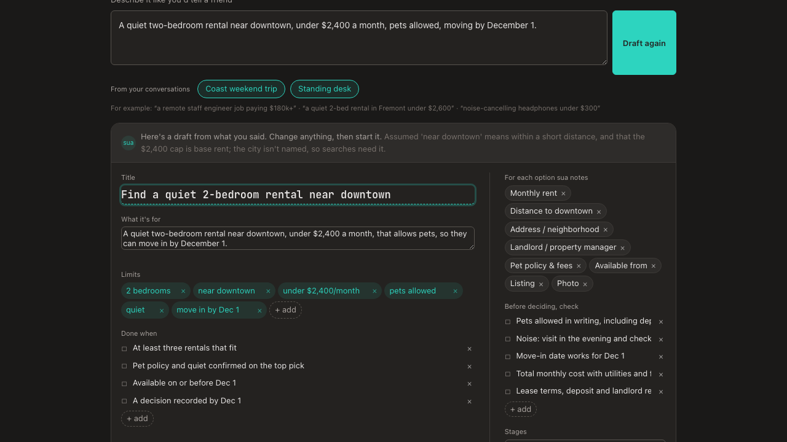
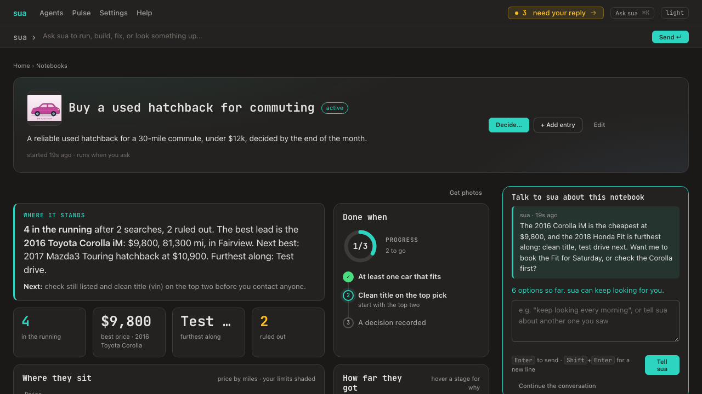
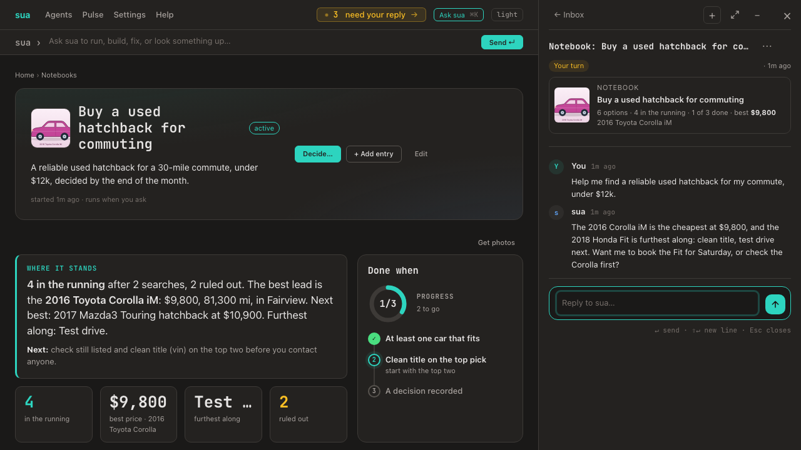
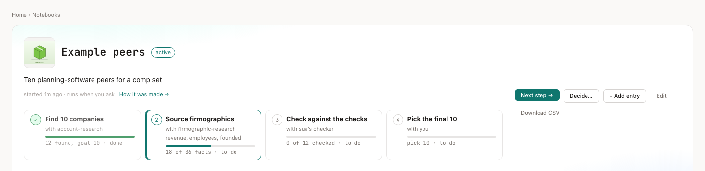
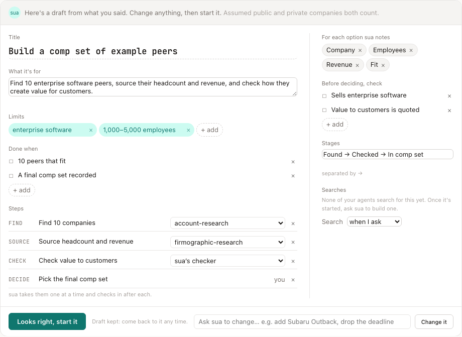
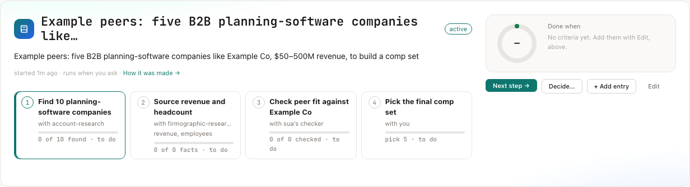
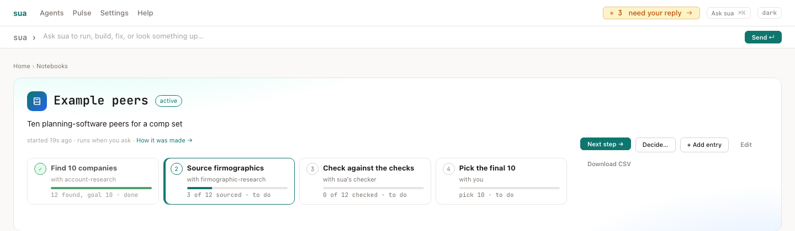
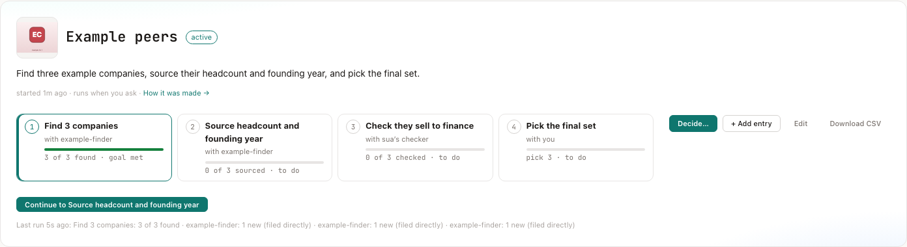
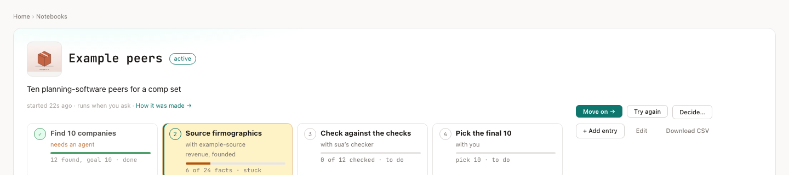

# Notebooks

A **notebook** is a goal you keep over time, like "Buy a used car" or "Find a new job". It holds:

- **what it's for**, in a sentence ("Find a reliable used SUV for family trips, and decide by Oct 15");
- **parameters**, the bounds it works within ("AWD", "under $26,000");
- **done when** criteria, ticked as they're met;
- a **pipeline**, the agents that gather for it, and how often they run;
- **entries**: options you're weighing, notes, evidence, and decisions, each with who added it;
- finally, **a decision** that closes it.

## Where to find them

**Notebooks** is in the top bar, first after Home. Notebooks also show up:
- **on Home:** the **Your notebooks** shelf, a card per active notebook with its best option, its price and its picture (another option's when the best has none yet), criteria as dots, and **sua asked you** when sua is waiting on you; plus **+ New notebook**. Home's **Ask sua** card has a **Start** row too: your templates, the kinds of notebook you've made ("Prepare for a meeting with …"), and a report. On Today each active notebook is one row: in **Needs you** while sua waits on your reply, otherwise in **Happening now** with its progress;
- **at `/notebooks`:** the list, with dots showing progress, plus **New notebook**;
- **through sua:** ask "where's my used car goal?" or "what did I decide about the car?", and sua answers from your notebooks with a link.

- **The Notebooks page** lists them as cards (**+ New notebook** is at the top right). Each has a cover: the best kept picture among options still in the running (a listing photo first, then an example photo, then an illustration), or until there is one, a cover drawn for it in its own colour with an icon for what it's about (a car, a job, an instrument, a bike, a laptop, a home…) and its stages. Opening the page also starts finding pictures for options that have none. Under the cover: the title (with a **decided**, **stopped** or **archived** chip; active ones have none, since the tab says so), what it's for (or what you decided), the best price with its lead option, one line of counts ("61 options · 3 in the running · at Facts sourced", the last being the furthest stage any option has reached), and at the bottom its done-whens as dots ("●○○ 1 of 3 met"; hover for which) beside when it was last updated. Tabs show **Active** (the default), **Decided**, **Stopped** or **All** with counts, plus **Archived** when you've archived any; search matches titles, goals, decisions and limits; sort by recently updated, newest or A–Z; 12 to a page.

## Archiving and deleting

Both are under **Manage this notebook** at the bottom of a notebook's **Edit** page.

- **Archive** hides the notebook:
  - from your notebooks (**All** too), Home's shelf, Today, sua's notebook list and the agent catalog's "fills notebooks";
  - its schedule stops.

  Nothing in it is deleted, and its address and its options' pages still open, with an "Archived" note and **Restore**. Find it under the **Archived** tab. Restoring it brings it back as it was; its schedule waits for its next slot rather than catching up. Its conversation with sua still shows the notebook's card, and sua still files into it there.
- **Delete…** asks once, then removes the notebook and everything in it:
  - options, notes, evidence and decisions;
  - price history and searches;
  - passes, kept photos and its layout.

  Its page and its options' pages stop existing. Its conversation with sua and the runs that fed it stay. It can't be undone. While its pipeline is running, delete waits until the run finishes.

## Starting one



**+ New notebook** (on Home's shelf or the Notebooks page) opens **Start a notebook**:
1. **Say it in a sentence**, the way you'd tell a friend ("a reliable used hatchback for my commute, under $12k, within 50 miles, decide by the end of the month"), then **Draft it** (or press Enter).
2. **sua drafts the notebook:** a title, what it's for, your limits, what "done" means (with your deadline), what to note for each option, what to check before deciding, the stages an option moves through, and which of your agents could search for it, with how often.
3. **Check it.** Every part is editable: change or remove a limit, add a check, edit the stages, untick an agent. Or ask sua to change it ("only over-ear, drop the deadline").
4. **Looks right, start it** creates the notebook already set up, and sua says hello in its conversation with the next thing to tell it.

Under the box, up to three **pills from your conversations** suggest notebooks you might want: things you were looking for, researching or choosing with sua that aren't notebooks yet ("Tires for the RAV4"). Clicking one fills the box with the sentence; then **Draft it**. sua refreshes them in the background about twice a day (the `notebook-suggester` agent reads your own conversations, including finished and dismissed ones, but not a notebook's own conversation or sua fixing its agents).

Nothing is created until you start it. **Skip the draft** starts the notebook from your sentence alone, and sua asks the rest in its conversation.

**A draft is kept until you start or discard it**, so you can leave the page and come back:
- Once sua starts drafting, the page's address becomes `/notebooks/new?draft=…`, so Back or a reload returns to it, even while sua is still drafting.
- Your changes to the draft (title, limits, checks, stages, which agents search, how often) are saved as you make them ("Draft saved"). An agent you untick is still offered when you come back.
- **Drafts you haven't started** are listed on the Notebooks page and on **New notebook**, each with where sua got to (drafting, ready to check, or couldn't draft it), **Continue →** and **Discard**.
- **Change it** keeps the same draft. **Draft again** from the sentence replaces it. Starting the notebook clears it.
- Drafts are stored with the dashboard, so a restart doesn't lose them. One that was mid-draft when the dashboard stopped reads as failed ("Draft it again"). If a change fails, the draft before it comes back. A draft untouched for two weeks is dropped.
- The sentence you're still typing, before **Draft it**, is kept in your browser.

## Talk to sua; it fills the notebook

**When you start a notebook, sua says hello first.** Once it has set the notebook up, it posts a message in the notebook's conversation:
- **First, the one most useful thing to tell it:** what the notebook is for, your limits, or any options you've already seen.
- **Then how it'll keep the notebook:** what it notes for each option, the stages, and what "done" means.
- **Then a Start button for its first step**, when sua can run it: a step its own agent, sua's finder or sua's checker works on, not one that's yours (Decide, Narrow) or a source step with no agent yet. "Press **Start** when you're ready and I'll begin with **Find 5 desks**." **Start** runs step 1, the same as the header's **Next step →**; **Not now** leaves it for later. Once the step has started or moved on, the button does nothing.

The conversation waits on your reply, so it's on Today. On the notebook page, the message shows under **Talk to sua**, and the big start box points there instead of offering a second place to type.

**The conversation shows its notebook.** In the inbox and in the sua drawer, a notebook's conversation has a card under its title: the notebook's picture, name, how many options are in the running, criteria done and the best price so far. Click it to open the notebook.

You don't fill in a notebook by hand. A new notebook opens with **Tell sua what you're looking for**. Talk it through: who it's for, budget, must-haves, what you've seen or ruled out. The conversation opens beside the page in the sua drawer.

- **sua files what you say as you go**, and the page updates on its own:
  - preferences and context become **notes**;
  - specific candidates become **options**;
  - facts about them become **evidence**;
  - "skip anything with a salvage title" becomes a **ruled-out decision**;
  - limits and "done when" lines are added to the notebook's parameters and criteria.

  This follows your autonomy setting: under Full it applies right away, otherwise it waits as a card. Every entry can be removed.
- **sua suggests a pipeline** when there isn't one, from agents you have (e.g. a listings search every morning). That's a **Set up the pipeline** card you approve, and it can run once right away.
- **Agents sua runs in the conversation feed the notebook.** A search becomes options, evidence, or a note such as "Searched Seattle Craigslist for Foresters: nothing that fits yet", each linked to its run. When sua builds an agent for the notebook, it offers to add it to the pipeline.
- **New limits replace the ones they contradict** ("budget is now $3–6k" drops the old range).
- **Corrections change the option itself.** Say "the price is actually $136.64" or "it's 30 inches, not 24", and sua updates that option's facts, so its card, its page, the chart and the stats change too. It isn't filed as a separate note. The option's history shows **Corrected**, with what it replaced ("Price $4,023 → $136.64"). The old source and estimate mark for that fact go. A correction stands over the option's own title and earlier searches. A corrected price starts the price history over, so fixing a wrong price doesn't read as a price drop.
- **The notebook keeps its conversation.** the page shows sua's latest message, **Continue the conversation** reopens it, and a conversation started from the notebook's page belongs to it. To add an entry yourself, use **+ Add entry** in the notebook's header.

- **A conversation that turns to a notebook** sees it too. Ask "which notebook should I work on next?" anywhere, pick one, and once sua's reply links just that notebook, sua has its options, steps and fields for the rest of the conversation, as if you'd asked on its page. sua sees every option still in the running, however long the notebook's history, so its count matches the page's. Results of searches you run there still go into the notebook only from its own conversation.
- **When something waits on you, the page says so,** with the drawer closed too. A bar under the notebook's steps and the top of **Talk to sua** turn amber:
  - **sua needs your answer** (a question), **sua needs your OK** (a card to approve) or **Something failed**, with the ask and a button that opens the conversation;
  - or **Your step**, when nothing is asked there but the next step is yours (Decide or Narrow), with **Decide…** / **Narrow…** and **Ask sua**.

  If it starts waiting while you're on the page, a toast says so, and **Open** goes to it. While sua is replying there, or a step or pass is running, the same bar says so with a moving dot, and **Watch** opens the conversation.
- **With the sua panel open,** the page's **Talk to sua** box is hidden, so there's one place to type, and the notebook widens into the space it leaves. Closing the panel on the notebook's conversation refreshes the talk box and the notebook, so sua's latest reply shows.
- **Enter sends** what you type in **Tell sua** (as in the drawer); **Shift+Enter** starts a new line, and **Cmd/Ctrl+Enter** sends too.

## A notebook's page





**The header shows the notebook's picture** (a listing photo, an example photo or an illustration of the lead option), the same one its card and conversation show. A notebook with no picture yet shows the notebook icon.

**The sua panel follows you to a notebook.** Open a notebook with the panel open (docked or wide) and the panel switches to that notebook's conversation. A closed or minimised panel stays as it was.

- **The cover** shows the title, status, what it's for, the parameters, and the cadence. The pipeline is drawn as connected agents, each with its last run (ran, failed, not run yet, not installed). Without widgets, a ring shows how many criteria are met (click a criterion to tick it); with widgets the header is compact (see [Steps](#steps-the-work-in-order)).
- **Its sections** are drawn from the notebook's own surface (`notebook:<id>`; see [surfaces](surfaces.md)):
  - **Options**;
  - **Notes and decisions**, with decisions first;
  - **Evidence**.
- **+ Add entry** (in the header, beside **Decide…**) adds a note, an option, evidence, or a decision.
- **Edit** (in the header) opens the notebook's Edit page. You change the notebook by saying what to change, editing it as a document, or picking how it looks, and see it before anything is saved:
  - **Talk** (the first tab): the notebook in a few lines (what it's for, limits, done-whens, what it notes, its steps, how it looks), then say what to change, the way you'd ask a person ("add a step to learn about her company", "put who she is at the top", "stop noting the price"). sua changes the setup (the drafter that drafts new notebooks); when what you said is about the page, or the notebook's own page no longer fits what it does, the page agent changes the page too, starting from the one it has. sua answers with what it changed, one line each.
  - **Prompt** (the second tab): the whole notebook as a markdown document: `# Title`, what it's for, then **Limits**, **Done when** (`- [x]` for met), **Facts each option notes** (`- Price: money, price, lower is better`), **Checks**, **Steps** (`1. Find 8 wagons (find 8; with an-agent)`, `(profile; about Dana Reyes)`, `(source; facts revenue, employees; top 5)`), **Stages** (`Found → Checked`), **Agents and schedule** and **How it looks** (a ready-made look by name; a document with the older **Page** heading still works). **Show in the preview** takes it as your change and opens the preview; a section you leave out stays as it was. On **Talk**, a request with nothing more said ("do it better", "improve it", "redo it", "redraw it", "clean it up") does both in one proposal: it enhances the whole notebook, as below, and sua draws its page again to fit what it's for. A request that says what to change ("make it better for the launch") is taken as it is. **✦ Enhance this prompt** has sua make it a sharper prompt for its goal, starting from what's in the box (your edits included). It makes what it's for one specific sentence, the limits concrete and checkable, and the done-whens 2 to 4 outcomes you can tick off. It also checks that the facts have the right types and roles, that the checks are things to confirm with a source, and that the steps fit the goal: decide for a choice, write (answer) for a question, write (plan) for a plan, a schedule for a watch. It never adds goals or facts about the world. It comes back as a change in the preview with a line on what it made sharper; nothing is saved until you save. **Edit field by field** (folded under it) is the setup form, which saves straight away.
  - **Preview** (beside the tabs; **Preview changes** once there are some) opens the notebook's page as your changes would draw it, header and all, over the editor. It opens by itself once when sua finishes a change or you show the prompt in it, says "as it is now" or "with your changes, not saved", and has **Save changes** in its bar. **Close**, Escape or a click outside it goes back to editing.
  - **Save changes** (in the bar that lists them) makes them the notebook: a step you kept keeps how far it got (matched by its title, else its kind and place), the step that's running can't be removed, met done-whens stay met, a fact you kept keeps what options have for it, and a page you changed is yours (the notebook won't pick another). **Discard** drops them. Unsaved changes wait for you (two weeks) and aren't listed with new notebooks' drafts.
  - **How it looks** (the third tab, beside Talk and Prompt) shows each look as a small picture of its page, drawn from the page itself (its rows and widths, a portrait, numbered points, quotes, a map, a grid of options), with a line on what it's for, the way Settings → Appearance shows brands: the look made for this notebook (when it has one), **Shortlist**, **Meeting briefing**, and **Let sua pick** (the page agent reads what it's for and draws one). The one it has says **Now**; one you picked says **In your changes**. Picking one puts it in your changes and opens the preview; Save or Discard as with any change. **Undo the last saved change to how it looks** goes back one saved look.
  - **Manage this notebook** (folded at the bottom) lists its actions one a row, each with a sentence on what it does: **Stop** (or **Reopen**), **Save as a template…**, **Archive** (or **Restore**) and **Delete…**, which asks first.
- **The schedule runs the pipeline.** A notebook with a schedule ("every morning") runs its searches when it's due, the same as pressing Run. The header says when it runs next. Each due time runs once. After the dashboard has been off, it catches up with one run, not one per missed time. A new or changed schedule waits for its next time. A schedule needs at least one search to run; without one the header says so. Scheduled runs are marked **on schedule** in **How it was made**. Schedules run while the dashboard is running (always, under `sua daemon`). See [ADR-0050](adr/0050-notebook-schedules-run-in-the-dashboard.md). Editing the criteria keeps the ticks on the ones you didn't change.
- **Decide…** lists the options still in the running, best first, with their fit, price or measure and how many checks they pass. Tick the ones you chose (one, with a radio button, when the decide step wants one), say why if you like, and **Choose these N and close**. The picks are marked chosen, the decision ("Chose Acme and Hooli. Closest in size") is kept as an entry, the decide step is done, and the notebook closes. **Pick the top N** ticks the best N for you. When sua has recommended some in your conversation, they carry a **sua** badge and **Tick sua's picks (N)** ticks exactly those (its latest recommendation replaces the one before). Each row shows the option's picture when it has one. Chosen options carry a **✓ chosen** ribbon on their shortlist card (a chip in the table view and on the option's page). Once you've decided (closed it), the shortlist shows just the chosen ones, first (untick **Only chosen** to see the rest; that's kept per notebook in your browser), **Where it stands** says what you decided, and the funnel's **Chosen** counts every pick. With nothing in the running, you just say what you decided. **Save picks, keep it open** marks the ticked ones chosen without closing: for a notebook you keep shopping from ("I bought this one"). You can also pick one at a time: **Pick this one** on an option's page and **Pick** on its shortlist card (click **✓ Picked** or **Unpick** to take it back). A decide step is done once it has as many picks as it wants, and open again if you take one back. A decide step's card has its own **Pick N… →** button, which opens Decide…. **Reopen** any time (your picks stay ticked); **Stop** pauses a notebook without deciding.

## Option facts

Options record their facts as data, not only as text, so they can be compared, sorted and charted.

**Numbers are checked against what the search said.** When the keeper files what a search found, every number it gives (a price, miles, a width, a count) must appear in that run's output. It's matched the ways people write it: "$4,023", "4.9k", "157k mi", "1.2M", "18 million", "125–175k", "two hooks", within 1% for rounding. A number the output never states is left out rather than guessed. The run's note on the notebook says so ("1 number not in its output left out"), and a later search that states it fills it in. Facts setup gives an option must appear in that option's own text, or in the output. An agent that files its own `<notebook>` block from code isn't second-guessed.

- **Each notebook has fields:** what every option records, e.g. price, miles, year, location and listing for a car; rent, sq ft and neighborhood for a flat.
- **sua sets them up for you,** along with the stages: in the background when you start a notebook (from its goal), when a notebook has options but no fields (the first time you open it, or right after sua files an option from your conversation), or the first time a search finds options. Setup gives options already in the notebook their facts, read from their text. While it runs, the page says "sua is setting up what to track…" and redraws when it's done; it's tried once per notebook. Each field has a type (money, number, text, link, image, date) and, optionally, a role. The roles are what let one widget work for any notebook:
  - `price`: what it costs;
  - `measure`: the main number to compare;
  - `place`;
  - `link`: the listing;
  - `image`;
  - `when`;
  - `org`: the company or seller, to group by;
  - `quote`: what someone said, or what suggests it (a briefing's evidence);
  - `ask`: a question to raise about it.
- **Money and number fields say which way is better.** A price is better lower, a salary or a rating higher. Ranking and charts use it, and a `price` field is better lower unless the notebook says otherwise.
- **Ranges:** a money or number field can take a span ("$150k–$180k", shown as $150,000–$180,000). Sorting and charts use its midpoint.
- **Any kind of search fits.** For a car: price, miles, year, location, listing. For a job: salary (a range, better higher), company (`org`), commute, posted date, posting. For a product: price, rating (better higher), store (`org`), photo.
- **Options kept before the notebook had fields** get filled in from their text when the fields are set. Only unambiguous facts are read: a dollar amount, a number with the measure's unit, a leading year, a web address.
- **The same option is one entry.** Each option has a fingerprint: a VIN or listing id when the agent gives one, else its listing's address. When a later run finds it again, its facts are refreshed and the card says "seen again". It isn't added a second time.
  - **Companies match by name.** In a notebook whose options are organizations (each option's title begins with its company, as in "Motive: planning and forecasting"), a run that names a company the notebook already has, as "Motive" with its employees and founding year, fills in that option's facts instead of adding it again. This holds even with no website to go by, and even when the run repeats the option's exact title. It applies only when the company names exactly one option. Notebooks of listings or jobs never match this way, since two "2008 Subaru Forester" listings or two Stripe postings are different options.
- **On the page**, an option shows its facts as chips (the price highlighted) and its listing as a link.
- **Price history:** each time a search finds an option, what it said is kept. A card shows how the price moved since it was first seen ("↓ $123 since Oct 5"): green when it moved the way that's better (lower for a price, higher for a salary), amber otherwise.
- **Photos:** a notebook keeps a copy of each option's photo, so a card shows the actual car (or flat, or product), even after the listing is gone. After each search, when you open the notebook, and when you press **Get photos** on the Options heading, sua tries options that don't have a listing photo yet (an example photo or an illustration doesn't count; a real photo replaces it):
  - the option's image field (role `image`), when the search gave a photo address;
  - otherwise its listing page's own preview photo. The listing is the option's link field, or when the notebook has none, the first of its facts holding a web address (an "Availability" field with a product page counts; it also gives the option its **Listing ↗** button). The photo is used only when the address is one listing (it carries an id, not a page of results) and the page's title names the option (its year and model). A results page shows a generic picture, which would be the wrong car.

  Every photo is fetched with the same guards as web pages (no private or local addresses, every redirect checked) and must be a real JPEG, PNG, GIF or WebP of at most 3 MB; never SVG. The copy is kept in sua's database and served from your dashboard, so the page never loads from the seller's site. The browser checks back each time it shows one (a quick "not modified" when it hasn't changed), so a picture that changes, a drawing replaced by a logo or a better photo, shows at once. An address that didn't give a photo isn't tried again, and an option keeps its example photo or illustration when it doesn't. Images are requested as WebP, PNG, JPEG or GIF, so image servers that would otherwise send AVIF (which isn't kept) send one of those. Some sites block automated requests (AutoTrader serves a "page unavailable" page), and results-page links give no photo, so the most reliable source is a search agent that returns each listing's own link and photo address.
- **Representative pictures:** an option still without a photo (the listing gave none, or blocked the request) gets a **representative** one: sua's `notebook-picture` agent searches for a picture of what it is (a Wikimedia photo of that model and generation, the product's image, the company's logo), fetched with the same guards as listing photos (one at a time, retrying a busy host; large Wikimedia originals as 500px thumbnails). When none can be found or fetched, sua shows its own **illustration** of what the option is (a car, a bike, a guitar, a laptop, a home, a company's monogram for a job), tinted per option and labelled with its name, and tries for a real photo again a day later. Cards label them **example photo** or **illustration**, so they're never mistaken for the real one. This runs after each search, from **Get photos**, and when you open a notebook or the Notebooks page; ruled-out options are skipped.
- **Company logos:** in a notebook of jobs or companies (one with a company field, about jobs, roles, accounts, vendors or leads), an option's picture is its company's **logo**, taken from the company's own website: its app icon (`apple-touch-icon`), else an icon it lists at 96px or larger, else a 128px favicon from Google's favicon service. One smaller than 48px (a plain favicon) isn't kept. The website comes from the option's facts (a website field, or its link when that's the company's own site, a careers subdomain included), never from a job board, applicant tracking system, recruiter or LinkedIn page; otherwise `notebook-picture` names it. A logo the agent finds itself counts as one too, and example photos it had described as a logo become logos. A logo shows whole on a white tile, in both themes, with no label, sized by its shape so it reads: a wordmark (1.6 times as wide as it is tall, or more) fills the frame's width, and the notebook's header gives it a wider tile; a square app icon sits at about half a large frame's height, with a margin in a small one. Options that don't name their company keep their monogram illustration.
- **Pictures show whole.** Everywhere a picture appears (shortlist cards and table, the option's page, the notebook's header, the Notebooks page, Home's shelf, the conversation's card), it's scaled to fit its frame, never cropped. A tall photo (a guitar) sits in the middle of a wide frame, and every card in a row keeps the same frame size however tall its photo is. A frame holding a photo is the card's own surface, so a product shot on white blends in; illustrations keep their tinted frame. On the Notebooks page, a soft, blurred copy of the cover photo fills the rest of its frame, so a wide frame has no white bands beside a photo. The same goes for pictures in messages, run output and Pulse tiles: they scale down to fit their column.
- **Not seen lately:** each search is recorded, along with how many options it found. When the last 2 searches by the agent that found an option found other options but not this one, its card says "not in the last 2 searches". It may be sold, filled or taken down. A search that found nothing doesn't count, since web search results vary from run to run. Being found again clears it.
- **For widgets:** `GET /notebooks/<id>/data.json` returns the notebook as data, the same shape for every notebook:
  - `limits`, `criteria`, `progress` and `fields`;
  - `options`, each with its facts by key, `priceHistory` and `priceChange`, `missedSearches` and `notSeenLately`, plus `price`, `measure`, `place`, `org` and `link` picked out by role, `image` (the kept photo's address on your dashboard) and `imageSource` (where it came from) (a range's midpoint for `price` and `measure`), and `firstSeenAt` / `lastSeenAt`;
  - `notes`, `evidence`, `decisions` and `history`.

## Widgets

Once a notebook has fields and options, its page is drawn as A2UI widgets (see [A2UI views](a2ui-views.md)), the same for a car, a job or a product:

- **Where it stands:** a short paragraph (how many are in the running; how many still need their checks and how many lack their own page; the best lead and the next best; the furthest stage; and the steps left) with **Next:**, e.g. "check still listed and clean title on the top two before you contact anyone". Beside it, **Done when** shows a progress ring and the steps, with the current one highlighted.
- **Stats:** in the running, best price (or pay), furthest along, ruled out.
- **Where they sit:** price against the main measure (miles, sq ft, commute). Your limits are shaded, the best lead in the running is highlighted, and ruled-out options are hollow. Hover or tap a dot for its name, price and measure in full, and where it stands. Click a dot to open [its page](#an-options-page); on a phone, tap it, then **Open →**. **How far they got** shows the funnel per stage, with ruled-out counts (hover for why).
- **Shortlist:** cards (photo or "No photo yet", rank, a short name, price, facts, stage, price move) or a table. A card's or row's name opens the option's page. **Filters** above the cards narrow the list. Each shows as a row of chips, and each chip says how many options picking it would show:
  - **Last run:** **New** (first found by the last run that found options), **Seen again** (already here, and that run found it again), or **Earlier**. A step or pipeline run of several agents counts as one run, and a later search that found nothing doesn't replace it. New cards carry a **new** tag. After a re-run, the header says "**3 new in the last run →**", which opens the shortlist showing only those. The address `?added=new` does the same. This filter doesn't show after the first run, when every option is new;
  - **Listing:** current, or not seen lately;
  - **Stage**;
  - each text fact the options differ on (seller, make/model, location…), when at least two options share a value and the values are short. A fact where every option has its own value (a company name) or that's a sentence about each option isn't a filter: a chip would pick out one option.

  Filters combine. Ranks and the best stay those of the whole shortlist. **Clear filters** resets them, and your choice is remembered in this browser for that notebook. Ruled-out options are **hidden by default**; **Show ruled out (N)** brings them back, and your choice is remembered in this browser. Each card has **Listing ↗**, **<next stage> →** and **Rule out…**, whose first choice is **No longer available** (sold, filled, out of stock), followed by quick reasons or your own words. "Not seen lately" cards also offer **Mark gone**.
- **Short labels for long facts.** When a fact is a sentence per option ("Office-of-CFO suite: close, consolidation, compliance, disclosure"), sua's `notebook-facets` agent groups its values into a few short labels ("Office of the CFO", "Finance-led FP&A", "Connected planning"), and the shortlist filters by those. It runs in the background when you open the notebook and some value has no label yet; new values reuse the labels already there. A value not labelled yet has no chip until it is, and a failed try waits a day. The labels are kept with the notebook.
- **Before you decide** (a third of the row): a checklist for the top two (the notebook's checks, e.g. Still listed, Clean title). Tick boxes right there.
- **How we got here** (two thirds of its row): a timeline, newest first. **Each search** shows which agent ran, when, its run (linked), and how many options it returned, plus which sites it reached when known; searches from before that was recorded are rebuilt from the options each run added, and **failed runs** of the agents that feed the notebook show too (they leave nothing else behind): runs made for this notebook (its pipeline, its steps, its conversation), and any run of an agent only this notebook uses. A shared agent's failures for another notebook stay off this one's timeline. Notes, decisions and rulings, and moves are there as well. The same event again in a row (the same agent's "Search returned no options", say) folds into one row with **×N** and its time range; **show N** lists each, with its run. Filter chips (**All**, **Searches**, **Notes**, **Decisions and rulings**, **Moves**, each with a count) and a **search box** (title, note, agent, every word) narrow it, with "N of M"; **Show N more** goes past the first 8 rows.
- **Where sua looked:** the latest search's sites: how many it found on each, and which were blocked or skipped. **Limits:** your limits, with ones that disagree (two different budgets, two mileage ranges) flagged.

A notebook without fields shows cards instead. The widgets bind to the notebook's data (`/notebook/...`, the same as `data.json`).

**Layouts.** The page above is the **Shortlist** layout, for choosing among many options. A layout is an [A2UI](a2ui-views.md) document kept with the notebook: any of the catalog's components (callouts, key/value lists, tables, the shortlist, the timeline…), bound to the notebook's data (`/notebook/...`). So a notebook's page can be drawn to fit what it's for. Two notebook extensions make one document fit many notebooks:
- `"when": "map"` on a component draws it only when the notebook has it. The flags are `map` (a price and a measure), `funnel` (2+ steps or stages), `steps`, `options` and `decided`, and `"!decided"` negates one. A part left out leaves its row, and the row's other parts share the space.
- `{"path": "/notebook/layout/sort"}` as a value fills in a setting from the notebook. The settings are the map's labels, formats and note, and the shortlist's sort, filters, CSV link, stage chips and chosen-first.

**Pages read like a magazine, not a grid.** A drawn page's parts take a treatment instead of all being framed boxes: a **lede** opens it (no frame, a teal eyebrow), a **feature** carries the main story (a rule above its title), **asides** hold facts and context beside it (a hairline on the left), a **band** is a full-width strip, and **plain** (a frame) is kept for tools. The briefing parts have expressive versions: a person as a **cover** (a large portrait or initials, their name in display type, a pull quote of the first thing they said), the agenda with large **numerals**, facts **ruled** line by line, and quotes **led** by one set large. Rows are full width or 2:1, 1:2, 3:2, 2:3, 1:1 or 1:1:1, never the same shape twice in a row; a page has one lede, at most 3 framed parts, and long lists only in a feature or a fold. When the notebook draws its own page and it reads like a grid, it gets one more try with what to change; if that try can't be drawn, the first stands. **Meeting briefing** is a ready-made page in this style (the cover beside what's known about the person, the agenda beside their company and its facts, then what they said, the research folded), and a notebook that prepares you to meet someone starts from it. See DESIGN.md, "Notebook pages".

**The header is part of the page.** A page can begin with a `NotebookHeader`, which shapes the header above it: a subtitle ("Meeting briefing"), no cover when the lead option's picture isn't what the notebook is about, what it's for shown or not, the steps strip folded to one line ("Steps: 3 of 4 done · now: Choose talking points"), and a small part drawn on its right (a short agenda, a few stats). The header's buttons, steps and "Your step" work as always. A page without one has the usual header. See [ADR-0059](adr/0059-notebook-header-in-layout.md).

**No part runs on.** Lists on a drawn page show a few rows, then "Show N more": what they said (QuoteList) 4, at most 6; the agenda's questions 3, at most 5; the timeline 6, at most 8; a table 8, at most 12. Pages are drawn to open with a row of short parts side by side, with long lists lower or folded.

**Learning about who it's about.** A notebook that prepares you to meet someone can start with a **profile** step ("Learn about Dana Reyes", its `subject`). sua's researcher (`research-one`) looks the person up: their role, company, where they're based, background, what they're known for, their site and LinkedIn, and a photo. If it finds their company, it looks that up too: what it does, website, size, stage, founding year, headquarters, recent news. A company alone is looked up as a company. The researcher is told the links you gave the notebook first (in what it's for, what you asked, or the meeting's notes), then what it's for and the meeting's goal and notes, so it can tell which person of a shared name it is. A LinkedIn profile you gave (`linkedin.com/in/…`) is kept as their LinkedIn, over any it found: LinkedIn can't be read, so research would otherwise list it as not found. Each fact is kept with the page it came from; what wasn't found is listed. sua keeps a copy of their photo only when it can show it's them: the page it's on must be about them (its title names them, and its address or kind says it's their page: an author, speaker, guest, team or about page, or their own site), and the picture must be theirs on that page (captioned with their name, or the page's own picture); logos, icons and banners never count, nor a page about two people, and it never reads LinkedIn. It looks at the research's photo first, then the pages the facts came from. The cover says where the photo came from ("Photo: sellbetter.xyz ↗", with why on hover), and **Not them** removes it and never uses that picture again. It keeps the company's logo from its own site, and the notebook's header shows their photo. Starting the step again always looks again (for a photo, or to learn more), and once it's done its card on the strip has **Look again →**, which learns about them once more without moving the steps (what it learned stays; a fact seen again is updated). The step is met with 4 facts. A later run updates what it finds and keeps the rest. The drafter and sua add a profile step first when a notebook prepares you to meet someone. A page binds them as `/notebook/person`, `/notebook/company` (ProfileCard), `/notebook/facts` and `/notebook/notFound` (FactSheet), and `"when": "about"` draws those parts once something is learned.

**Writing the talking points.** A notebook that prepares you for a meeting ends with a **write** step ("Write the talking points", its `target` how many, 3 to 5) instead of a decide step: you don't pick from what was found; sua's writer (`notebook-writer`) writes the points from it. It reads what the notebook is for, who it's about (the profile step's facts) and the themes still in the running (what they said, its source, the question, whether it was chosen or checked), and writes each point as something to raise ("Ask what she never hands to AI"), why it matters to them, a question, and the themes it rests on, by id. The quotes and sources shown with a point are those themes' own, never the writer's words; an id that isn't one of the notebook's themes is dropped, and a theme ruled out later drops off the point. It also writes more questions to ask and up to 3 things to watch for. The agenda ("What to talk about", `/notebook/talkingPoints`, `/notebook/questions`, `/notebook/watch`) and the brief show them; before the step runs they show the chosen themes (else the first 5) and their questions, as before. The step is met with enough points; once it's done its card on the strip has **Write again →**, which writes them once more from what the notebook has now (they're replaced, your edits too), and **Edit the points →**. **Edit** on the agenda (beside **Copy as text**) opens the same page: reword a point, why it matters and its question, move points up or down, remove some or add your own, and change the questions and what to watch for, a line each. The themes a point rests on stay as they are, so its quotes are still theirs. The briefing and its brief show what you save. A briefing page saved before agendas had things to watch for shows them too. The drafter and sua end a meeting notebook with it. A notebook whose steps don't have you pick or narrow (one that ends in a write step) has no **Decide…** in its header: there's nothing to pick from. See [ADR-0061](adr/0061-notebook-write-step.md).

**The meeting.** A meeting notebook (the Meeting briefing page, or a write step that writes talking points) keeps the meeting it prepares for: **when** (a date, or a date and time), **your goal** (what you want out of it) and **notes** (what you already know, who else is coming).

- **Where it comes from:**
  - sua's draft picks it up from what you said, resolving "Thursday at 2" against today, and shows it as **The meeting** on the draft;
  - the notebook's header asks for it when it's missing (**Add the meeting**), and so does sua's first message;
  - you can tell sua in the conversation ("the meeting's Thursday at 2; I want to agree on a pilot");
  - Edit → Prompt has a `## The meeting` section (`- When: 2026-10-29 14:00`, `- Goal: …`, `- Notes: …`).
- **Where it shows:** the header reads "Meeting **Thu, Oct 29, 2:00 PM** · in 3 days · Your goal: …", and the brief shows the same.
- **What it changes:**
  - the find step looks for what bears on your goal;
  - the writer aims the talking points at it: an easy opener first, the last point moving toward what you want, and watch-outs that cut against it;
  - your notes are taken as known, not explained back to you.
- **When the points are old:** once they're 3 or more days old with the meeting still ahead, the header says so, with **Write again →**.

**When what was found disagrees with who they are.** After a find, source or profile step, and before talking points are written, sua's reconciler (`notebook-reconciler`) compares who the notebook is about with what was found. It looks for disagreements about the present: their role, their company, where they're based, what the company does. Each one shows at the top of the notebook until it's settled, with the question (e.g. "Is she at Globex now, or still running Northwind?") and each side with its source and date.
- **Check it:** sua looks it up as of today, with both sides as leads, and keeps the sourced answer.
- **It's …:** keeps the side you know is right.

Until it's settled, the talking points state neither side; they open with a question that lets them say. See [ADR-0062](adr/0062-who-they-are-now-conflicts.md).

**Writing the answer.** A notebook that asks a question ("What do 10-person sales teams pay for a CRM?", "Is it worth upgrading to …?") ends with a write step that writes the answer: `"shape": "answer"`, written `Write the answer (write; answer)` in the Prompt tab. The drafter lays it out for a goal that's a question or something to find out rather than something to pick. Its find step gathers sources, and it ends with this step instead of decide. sua's writer reads what the notebook asks, the sources and findings still in the running, and the notes its research left. From those it writes:

- **The answer:** one to four sentences, the key part in **bold**.
- **How sure:** high, medium or low ("sure", "fairly sure", "not sure yet"), and why.
- **3 to 6 findings:** each rests on the sources it came from, by id. An id the notebook doesn't have is dropped.
- **What's still open:** up to 5 questions it couldn't settle, or what to check next.

The step is met once there's an answer, and **Answer again →** writes it once more from what the notebook has now. sua picks the ready-made **Answer** page for these notebooks, and you can pick it under Edit → How it looks. The page shows the question and the answer, or where it stands until there is one. Under that it shows what the answer rests on (the findings, each linking to its sources, then **Still open**) beside the steps, then the evidence as a table, and the research folded at the end. The brief prints the same, each finding with the sources it came from. Ask sua "what did it find?" and it answers from the same answer. The data paths are `/notebook/answer/*`, `/notebook/findings` and `/notebook/openQuestions`, and a page part can wait for an answer with `"when": "answered"`.

**Writing the plan.** A notebook that makes a plan ("4 days in Lisbon in March", "a week of dinners", "move house by June") ends with a write step that writes the plan: `"shape": "plan"`, written `Write the plan (write; plan)` in the Prompt tab. The drafter lays it out for a goal that's a plan rather than a choice or a question. Its find step gathers the places, things or options the plan could use, and it ends with this step instead of decide. sua's writer reads what it's for, its limits (dates, budget, where, who), what's in the running and the notes its research left. From those it writes:

- **The plan in a sentence or two.**
- **The items in order:** each with its day, date, week or slot ("Day 1", "Week 2", "Morning"), what to do, an optional line on when, how long or cost, and the options it uses (an id the notebook doesn't have is dropped). An item with no day joins the one before it.
- **Up to 8 things to book or do before it starts.**
- **What's still open.**

The step is met once there's a plan, and **Plan again →** writes it once more. sua picks the ready-made **Plan** page for these notebooks, and you can pick it under Edit → How it looks. The page shows the plan in a sentence (or where it stands until there is one), then **Day by day** (the new **Itinerary** widget, with Copy as text) beside the steps, then what it draws on, and the research folded at the end. The brief prints the same. The data paths are `/notebook/planIntro/*`, `/notebook/planDays`, `/notebook/planBefore` and `/notebook/planOpen`, and a part can wait for a plan with `"when": "planned"`. Itinerary is in the catalog like any widget, so a board or an agent's view can use it too: `days` as `[{when, items: [{text, note?, refs?}]}]`, with `before` and `open`.

**Keeping watch.** A notebook that keeps an eye on something over time ("tell me when a used X100V under $1,200 shows up", "watch flights to Lisbon in March", "track this price") is a **watch**:

- **What sua drafts:** a find step (source or check only when a fact needs its own lookup), no decide or write step, and a schedule. It searches every morning unless you said another rhythm, and you can change that on the draft.
- **The page:** sua picks the ready-made **Watch** page, and you can pick it under Edit → How it looks. It leads with **what changed since the search before the latest**, worked out from what the notebook keeps (never by a model):
  - **new:** listings or options the latest search found first;
  - **price changes:** each marked better or worse by which way the price should go;
  - **other facts that changed:** for example, a condition or a mileage;
  - **gone:** its page said it's sold or removed;
  - **not seen lately:** the latest search was the second in a row to find others but not this one (it may be sold or taken down). Said once, when it happens, not on every search after.

  A line sums it up ("Since Oct 20 · checked Oct 21: 1 new, 1 price change"), or says nothing changed. The first search is a "first look", not everything new.
- **Below that:** everything it's watching, then the research folded at the end. The brief prints the same.
- **For other pages:** the **Changes** widget is in the catalog (`items` as `[{kind, title, detail?, href?, tone?}]`), and the data paths are `/notebook/changes` and `/notebook/changesIntro/*`.

**A short part never sits beside a long one.** A cover, a callout or a few stats beside an agenda, quotes or a table leaves a hole under the short one; a drawn page that does gets one more try, and the Meeting briefing pairs the cover with the facts about them. **Edit** → **How it looks** offers the Meeting briefing (and any other ready-made look) as a picture to pick.

**A drawn page has no empty boxes.** A part of a drawn page with nothing in it yet (notes before there are any, a decision before it's made) is left out until it has something, and its row closes up; the brief does the same. The shortlist keeps every part, as it always has.

**The brief keeps a few of what they said.** "In their words" in the brief shows 3 to 5 quotes, one per theme before a second from any, and says how many more there are; the extended brief has every one under "Everything they said".

**The brief lists the links you gave and leaves out empty searches.** Links in what the notebook is for, what you asked, or the meeting's notes and goal are listed under its title, each once ("linkedin.com/in/dana-reyes"). Research activity leaves out searches that found nothing, so the activity that matters fits.

**Checking pages still fit their jobs.** Eight example notebooks, one per kind of job (a used car, a job, accounts by fit, a product, meeting a person, a call with a company, a question to answer, a trip), live in `packages/dashboard/src/lib/notebook-page-examples.ts`, with what the page agent answered for each in `fixtures/notebook-pages/answers.json`. On every change, the tests check that each gets the right kind of page, that it draws before and after it has data and reads well, that every part is bound to data it has (no empty box), that its outline only changes on purpose (a snapshot, so a change to a ready-made page or the drawing guide shows as a diff), and that its brief prints its parts in its order. Two scripts go further, on demand, after `npm run build`:

- `npm run notebook-pages:eval -- --runs 2` asks the real page agent (a few dozen model calls, in a scratch store) and prints a scorecard: the right kind of page, usable on the first try, the parts the job needs, the same answer each run, against `scripts/notebook-pages/baseline.json`. Run it before merging a change to the page agent, the guide or a ready-made page. `--record` saves its answers for the tests; `--write-baseline` saves the scorecard.
- `npm run notebook-pages:layout` opens each example's page in a browser (wide light, wide dark, phone) on a scratch dashboard that calls no model, flags holes beside taller parts, parts longer than a screen and a half, and sideways scrolling, and writes a contact sheet of screenshots. `--chrome <path>` uses a Chrome you have when Playwright's own isn't installed.

**Briefing parts.** Four components fit a notebook that prepares you for something (a meeting) rather than a choice: **Agenda** (what to talk about), **QuoteList** (what they said), **ProfileCard** (who they are) and **FactSheet** (what's known, with sources). A notebook gives the first two their data:
- `/notebook/quotes`: each option's quote (a field with the role `quote`: the evidence, what they said), with its source, date and question, grouped by the short label of the notebook's first labelled fact (a theme). Chosen options come first; ruled-out ones aren't listed.
- `/notebook/talkingPoints`: the chosen options, else the first 5 in the running, each with its question (a field with the role `ask`).
- `/notebook/questions`: the other options' questions, each once.

A shortlist has no quote or question fields, so these are empty there. A profile step (below) gives ProfileCard and FactSheet who it's about.

**Ask sua to change the page.** On the Edit page's **Talk**, or in the notebook's conversation, say what you want it to show or how ("put who they are at the top", "make this a briefing, not a shortlist", "a table of the themes with their sources"). sua draws the whole page and offers a **Change the page** card that lists what it adds, removes and changes. Only the page changes, never what the notebook has, and a page drawn for a notebook shows even before it has options. If the page changed after the card was offered, the card refuses. On **Edit** → **How it looks**, the look it has is marked **Now**, with **Undo the last saved change to how it looks** (the last 20 are kept) and the Shortlist to go back to.

**A new notebook decides its page.** Once sua has set it up (what it's for, the facts it notes, its steps), the notebook decides its page from what it's for. A choice among many options keeps the Shortlist; a notebook that prepares you for a meeting, answers a question or makes a plan gets a page drawn for that (`notebook-page`), with no card to approve. While it decides, the page says sua is setting it up; the greeting in its conversation says what was drawn. If the drawn page doesn't check out, sua tries once more with the reasons, then keeps the Shortlist. Once its first step reaches its goal, the notebook knows more (who it's about, its first options), so it decides again and says so in its conversation; it does this only while the page is still its own pick, never after you changed it (Undo, or picking a look on **How it looks**) or approved one of sua's page cards ([ADR-0060](adr/0060-page-decided-again-after-first-step.md)). A page the notebook came with (a template's) is never replaced. On **Edit** → **How it looks**, the look made for it says what it is, Undo puts the Shortlist back, and **Let sua pick** lets any notebook, old ones included, decide again (as a change you preview and save). See [ADR-0058](adr/0058-notebook-decides-its-page.md).

A notebook with no layout of its own uses the Shortlist, drawn exactly as before. A layout is checked when it's set: as a notebook with everything would draw it, it must be a valid A2UI view. A template keeps its notebook's layout, and a notebook started from it gets it. See [ADR-0056](adr/0056-notebook-layouts.md).

**No longer available** is not a ruling: the option leaves the running and reads "No longer available", not your reason. Tell sua too ("the RAV4 sold", "they filled the Stripe role").

**Facts are checked against the option's own text.** If a fact sua records for an option contradicts the year, price or measure its text states (a model can mix up two options), the text wins. That text describes the option when it was filed, though: when a later search finds the same option again (by its link) and sees a newer price or measure, the newer facts win over the text. Facts stored before this check are repaired when you open the notebook. A span in the text ("$150k–$160k") is a range for a range field (a salary), and a single figure agrees with a range it falls in ("from $170k" with $170k–$200k, which keeps the range). Options whose facts an earlier version cut down to a salary's first number, wrongly read as a contradiction, get their facts back from when they were filed the next time you open the notebook. Only numbers count: a link in the text (a source, the post a quote came from) never counts as a mix-up and never replaces the option's own link; it fills in only when the option has none. Fields without a role get the one their name implies (`price`, `miles` in mi, `listing_url`, `photo`, `location`, `seller`, and for text, `evidence` or `quote` as `quote`, `conversation_question` or `question_to_ask` as `ask`).

**Deciding** (**Decide…** in the header) lists every option still in the running to pick from: with steps, the ones that got through the most steps first, then the best fit (or price); without, the furthest stage first. Each row opens its option's page (↗). The count ("3 of 10 picked") follows the decide step's target. Recording the decision closes the notebook.

## An option's page

Each option has its own page at `/notebooks/<notebook>/entries/<option>`, with everything the notebook keeps about it. Open it from a dot on **Where they sit** or an option's name on the **Shortlist**.

- **Previous / Next** (top right, beside the breadcrumbs): the options either side of this one in the running, best first: **← #2 …**, **3 of 22**, **#4 … →**. The **←** and **→** keys do the same (not while you're typing).
  - They follow the filters you picked on the notebook's **Shortlist**: with **Listing: Current** on, Next skips listings not seen lately, and the count reads **2 of 5 filtered**.
  - A ruled-out option keeps its place: Previous / Next go to the ones either side of where it ranked (the count reads **ruled out · 21 in the running**), so after **Rule out** you can press **→** to go on.
- **The header:**
  - its picture;
  - its short name and full title;
  - where it stands: **best price** (or best fit), or **#3 of 12** in the running;
  - its price, with the latest move;
  - the controls the cards have (**<next stage> →**, **Rule out…**, **Bring back**), which return to this page;
  - **Listing ↗** and **← Back to the notebook**;
  - who found it, when, and when it was last seen.
- **What sua knows:** every fact, in the notebook's field order. The cards show at most five. A fact whose value is a web address (a link field, or any field holding one, like "Availability") is a link; on a card it shows the site (**target.com ↗**). An estimate reads **≈**, a fact with a source links to it, and the quote that backs a fact is shown under it (marked "checked in the source" when code found it there).
- **Price over time:** each price a search saw. It's shown once the price has changed.
- **Before you decide:** the notebook's checks for this option, whatever its rank; the notebook page shows them only for the top two. Ticking one saves it.
- **Its history**, newest first:
  - **Found** (or **You added it**);
  - each search that found it again, with **Price dropped / went up** and the old and new price;
  - its move to a stage;
  - its ruling and why.

  Each entry links the run behind it.

- **Talk to sua about this item** (beside the details): ask about this option, or correct it ("is it still available?", "the price is actually $136.64").
  - It goes into the notebook's conversation and opens it in the sua drawer.
  - The message names the option ("About “Zeus & Ruta…”: …"), and sua gets everything the notebook knows about it, so it answers about that one. A correction changes the option itself.
  - With the drawer open, the box hides and the details widen, as on the notebook's page.
  - Asking from the notebook's own box afterwards drops the focus on that option.
  - **"Next"** ("open the next item", "I'm done with this one, go to the previous") goes straight to that option's page, the same one the Next button names, without asking sua. Anything more ("rule it out and open the next") goes to sua: it does what you asked about this one, then links the next one (sua knows the options either side of it, in rank order).

A note, evidence or a decision has no page of its own; its address goes to its place in the notebook.

## Ranked by fit, not price

Some notebooks aren't about the cheapest option: accounts to qualify, leads, vendors. A field with the role **score** (how well an option fits, e.g. an ICP fit from 0 to 100, higher is better) changes how the notebook ranks:
- **Where it stands** names the **best fit** ("fit 88, 140 employees, in Austin") and the next best by fit.
- The stat shows the best fit, the shortlist is "ranked by fit, highest first", and each card shows its fit as the headline number with a **Best fit** ribbon.
- **Decide…**, Home's shelf and the Notebooks page pick leads by fit too.

sua's drafter adds a fit score to account-style notebooks ("companies with $10–50M revenue and 50–500 employees…"), keeps revenue a plain fact (not a price), and the keeper scores each option it files against your limits and criteria. A field named `fit`, `icp_score` or `match_score` gets the role on its own. Without a score field, notebooks rank by price as before.

**Where a fact came from.** A fact can carry its source and whether it's an estimate (revenue and headcount usually are). The keeper adds them when a run's output says where a figure came from or that it's approximate. On the shortlist, an estimate reads **≈ $30M–$40M** (dashed), and a fact with a source links to it (**$20M ↗**). When a later search states the fact again, its source and estimate flag are replaced (or cleared, if it's simply stated); facts it doesn't mention keep theirs. Agents can give a fact as `{"value": 20000000, "source": "https://…", "estimate": true}` instead of a bare value.

Money of a million and up reads short ("$18M–$22M"). Companies get a monogram tile from their company name when there's no picture.

### Templates

A notebook you run again and again (a job search, a car search, a comp set) can be kept as a template, and new ones started from it by asking sua.

- **Save one:** on the notebook, **Edit** → **Manage this notebook** → **Save as a template…** opens **Make a template from this notebook**:
  - **The template:** a preview of what a notebook from it starts with: its name, what it asks each time (highlighted wherever it goes), what it's for, limits, done-whens, checks, steps and the facts each option notes. Before you save, it's sua's first guess, which takes the name in the title as what changes each time.
  - **Talk to sua about the template:** say what you want ("make it work for anyone I'm meeting, a person or a company", "call it Prepare for a meeting", "drop the third check"), or click a starter. sua drafts the whole template and offers a **Save the template** card listing its words. It drops limits that only fit this time, makes the wording fit anyone ("him" → "them") and finishes text that was cut off. Approving saves it, and the preview updates on its own. Ask again to change it; saving the same name replaces it.
  - **Its page:** the notebook's page, drawn with this notebook's findings, as notebooks from the template will look once they fill. Ask sua on the notebook to change the page; the template keeps it.
  - **Edit the words yourself:** the same template as boxes, folded away: the name, what changes each time (what to ask, and what it was here), what it's for, limits, done-whens, checks, step titles and fact labels. Wherever the subject is named, the texts say `{subject}`.

  Archived notebooks can be saved too, so you can archive a finished one and keep its template. Saving the same name again replaces it.
- **What it keeps:** the notebook's setup, not its content:
  - **Kept:** what it's for, its limits, its done-whens (all unmet), the facts each option notes, its checks and stages, its steps (with their agents; status reset), its schedule and pipeline.
  - **Not kept:** options, notes, decision, history and filter labels. Every notebook made from it starts empty.
- **Start one with sua:** ask "start a notebook from my Job search template", or use **Start with sua →** next to it on **New notebook**. A template with a subject has a box for it there ("Acme Corp"); without one, sua asks it first. Every `{subject}` is filled in when you approve. sua then:
  - asks what's different this time, one or two questions per reply and at most 4 in all, each with button answers: the template's own value first ("Remote or Austin, TX"), then likely alternatives, or type your own. It asks about the limits that change between runs (place, level, pay floor, budget), how many to find and a deadline, and skips what you already said. **Use the template as is** skips the rest;
  - offers a **Create notebook** card showing the template, the title, the limits, done-whens and checks (before → after when they change: a check that names a place, level or pay floor changes with it) and the steps.
- **When you approve it:** the notebook is created empty with the template's setup and this time's changes. A step whose agent is no longer installed falls back to sua's finder or checker, or says it needs an agent. Nothing runs until you start its first step.
- **Archive or delete one:** on **New notebook**, **Archive** keeps a template but stops it being offered there or by sua. Archived ones fold away under **Archived templates**, each with **Restore**. Saving a template with the same name restores it too. The **×** deletes a template (it asks once). Notebooks made from it stay either way.

### A brief to share

**Open the brief** (under **Download / share**) shows the notebook as a summary of what it found, on one page to send:
- **The goal**, then the decision or where it stands. A decided notebook's decision shows once: when, how many were chosen, the picks as a list, and why.
- **Key findings**, worked out from the notebook itself (nothing written by a model, nothing guessed):
  - how many options were looked at, over how many searches, and how many are in the running, chosen and ruled out;
  - the span of the price or salary in the running (a salary range counts by both ends), and how many don't list it;
  - the fit span and how many score 80 or more; the main measure's span;
  - how they split on a short fact like Remote or Location;
  - why the rest were ruled out, grouped ("unfit (6); posting closed (4)", or the check they failed);
  - what's still open, and where the last search looked.
- **The shortlist as a table**: one row per option in the running, with the key facts that most of them state. Each name links to its own page, in the PDF too, and has the option's picture beside it (its photo, an example photo, its company's logo or its illustration), as on its page.
- **In detail**: each option's facts (not the ones its title already says), why it's there (the first sentence of its notes), its checks once any are ticked, and its own page.
- **Ruled out**: the latest 12 with their reasons.
- **Notes along the way**: sua's latest notes.
- **The limits and done-whens.**

Nothing is folded away, so a PDF has it all. It's self-contained (no scripts, no app around it), works in light and dark and at phone width, and prints cleanly:
- the light palette, colours kept;
- no option split across pages;
- each link's address printed after it.

**What's new** (under **Download / share**, once the last run that found options added some): **New in the last run** downloads a CSV of only those (`shortlist.csv?rows=new`). **Open the brief of what's new ↗** and **Save what's new as PDF ↗** give the brief of only those (`brief.html?latest=1`). It has their table and details, the ones from that run that were ruled out, and the notes since then. Key findings stay the whole notebook's.

**The extended brief** (an option under **Download / share**: **Open the extended brief ↗** or **Save extended as PDF ↗**) is the same summary, then **Each option in full**. Every option in the running gets what its own page shows: its stage, every fact (with its link, its source and the words quoted from it, or "an estimate"), its notes, each check ticked or not, and what happened to it (found, seen again, price moves, corrections), under its picture. The shorter **In detail** list is left out, since each option is there in full. When printed, each option starts a new page. By address: `brief.html?full=1`.

**A drawn page prints as itself.** When a notebook's page was drawn for it (a Meeting briefing, a report), its brief is that page, not the shortlist summary: the same parts in the same order and treatments, set for reading and print (the cover with their photo and where it came from, the facts in a ruled sidebar, the numbered agenda with every question, what they said with sources, the research at the end). Tables and timelines print longer than the page shows them (15 rows, 8 events); what they said shows 3 to 5 quotes, one per theme first, and the extended brief has every one. The extended brief then adds everything behind the page: **Everything they said** (every quote with its full source address), **Every fact, with its page**, and **Each one in full**. Charts don't print (the notebook has them). What's new (`?latest=1`) stays the shortlist brief.

**Save as PDF** opens it with your browser's print dialog (choose Save as PDF). **Download the brief** saves it as one HTML file, with its pictures inside it (each up to 600 KB, 8 MB in all), since the dashboard's own picture addresses need you signed in. Hand it to Claude to publish it as an artifact you can share by link. By address: `/notebooks/<id>/brief.html` (`?download=1` to save it, `?print=1` to open the print dialog).

### Each option's own page

A list is most useful when each option links to its own page: the listing, the job posting, the product page, not a search page that lists many. Agents are asked for that (a find step's job says so, and sua's keeper leaves out a results page rather than file it as the link). When a link is a search page anyway, because several options share it or it's shaped like one (`/search`, `?q=`, CarGurus `/Cars/l-…`, Edmunds `/used-2011-…-seattle-wa`, Craigslist `/search/`), its button reads **Search page ↗** instead of the listing, it never counts as two options being the same, and **Where it stands** says how many lack their own page once most do. To find them, add a source step that looks up the link field ("Find each car's own listing", with the link field's key as its fact); a search-page link counts as missing until it's replaced.

### Merging duplicates

When two options are the same one (a car listed twice, a company under two names), open either one's page and use **Merge with…**. Likely copies (the same address, the same name or company) are listed first with ★. The other one's facts fill in what this one is missing, its checks, picks and history come along, and it goes; this one keeps its own facts, stage, and whether it's ruled out. You can also tell sua ("those two RAV4s are the same car") and it merges them.

## Stages and ruling out: the funnel

Options move through the notebook's **stages** toward a decision, and you can rule any of them out.

- **Each notebook has stages,** e.g. Found → Checked → Test drive → Offer → Bought for a car, or Found → Applied → Screen → Interview → Offer for a job. The keeper proposes them along with the fields; you can change them on **Edit** (say so on **Talk**, or edit **Stages** under **Prompt**). New options start at the first stage. If you remove a stage, its options move to the first one.
- **Move an option along** with **Move to <next stage> →** on its card, or tell sua ("I applied to Stripe and Plaid", "we test-drove the RAV4").
- **Rule an option out** with **Rule out…**: pick a quick reason (Not interested, Too expensive, No reply, Failed a check) or write your own. Or tell sua ("rule out the XT, too pricey", "no callback from Plaid").
  - A ruled-out option **stays in the notebook,** dimmed and at the end of its section, showing where it was ruled out and why: "Ruled out at Applied: no callback". **Bring back** undoes it, and so does moving it to a stage.
  - **Ruled out stays ruled out.** When a search finds the same option again (same fingerprint), it isn't suggested again. The keeper also sees why options were ruled out and skips others that fail for the same reason. When three or more are ruled out for one reason, sua offers to make it a limit.
- **The funnel** above the options shows how many reached each stage and how many were ruled out there ("4 Found −2 → 1 Checked → 1 Test drive"); hover for the reasons.
- **With [steps](#steps-the-work-in-order), the funnel is the steps:** Found → Facts sourced → Checked → Chosen, counted from each option itself (its facts, its ticked checks, whether you picked it), not the stage it was moved to. An option counts as far as it got in order: one with every check ticked but a fact missing stops at Found. A step kind used twice goes by its steps' titles.
- **With steps, stages moved by hand are hidden:** shortlist cards and the option page drop the stage chip and the **Move to … →** button, the table's Stage column and the stage filter go, and a ruled-out option reads "Ruled out: why" rather than "at Found". The steps say how far each option got. Your stages are kept (Edit still lists them) and come back if you remove the steps.
- **In conversation, sua can also tick a done-when criterion** when what you said shows it's met ("the title's clean").
- **Done-whens that repeat the notebook's own work tick themselves**, when that work is done or when you open the page:
  - "A decision recorded", "decided yes/no", "A final set recorded" tick when you decide;
  - "At least 10 companies…" ticks once that many are in the running;
  - "… sourced for each" ticks when the source step reaches its goal (not when you moved on from it short);
  - one that names a check ("clean title" for the check "Clean title (VIN)") ticks when every option you chose passes it.

  Hover one to see what ticks it. Anything else is yours to tick. Once you (or sua, at your word) tick or untick one, it's left as you set it.
- `data.json` includes `stages`, a `funnel` (per stage: reached, here now, ruled out, top reasons; per step when it has steps), each option's `stage`, `stageIndex`, `ruledOut` and `chosen`, and `active` / `ruledOutCount`.

## How it was made

**How it was made →** (in the notebook's header) opens its **Workflow**: every run that filed into the notebook, the runs those started (a sweep's calls to other agents, loops, agents used as tools), and what each left ("3 options · 2 notes · saw 3 again"), drawn as one graph, left to right, the same way a run's steps are drawn. Click any box to open that run.

Runs come in **passes**: one go at filling the notebook. A pipeline run of all its agents is one pass (failed runs included); a run filed from the notebook's conversation, or with **Add to notebook**, is a pass of its own. Pick a pass at the top to draw it (the newest is drawn first); the list under the graph groups every run by pass, with each pass's note ("3 new entries · car-sweep: 3 new"). Runs from before passes were kept show as **Earlier run**, one each.

A run's own page links back too: **Notebook: *title* · how it was made**, including for a run that another agent started ("through the run that started this one"). A run another agent started counts as part of its parent's search, so it's never offered under **Runs not in this notebook yet** and never shows as a failed search of its own.

## Account research

The **account-research** agent fills an accounts notebook ("B2B software companies with 50–500 people that run Kafka and are hiring platform engineers") from what companies say in their own public job posts. It needs no API keys.

1. **Plan:** it breaks the profile into signals (the stack they run, the problem they have, the roles they're hiring) and searches the Ashby, Greenhouse and Lever job boards for them, skipping job aggregators and staffing firms.
2. **Read:** code fetches each company's posts from the boards' public APIs and keeps the ones that mention the signals.
3. **Score:** each company gets a fit score from 0 to 100 on a fixed rubric, backed by a word-for-word quote from its post:

   | Score | Tier | What the post shows |
   |---|---|---|
   | 85–100 | Tier 1, immediate fit | an active initiative or problem the profile is about |
   | 70–84 | Tier 2, high potential | the stack and senior hiring for it; the problem is implied |
   | 50–69 | Tier 3 | size or industry only |
   | below 50 | Unfit | filed as ruled out, with why, so the next search doesn't bring it back |

4. **Check:** code, not a model, checks every quote is in the post word for word. A score whose quote isn't can't rank above tier 3, and its card says so.

The notebook files the result directly: company, fit, tier, and the job post as the option's link. Under each fit score the card shows the quote, marked **✓ checked in the source** and linked to the post. Revenue and headcount are filled only when a post states them, and marked as estimates. Ideas from [account-fleet](https://github.com/NatesVibeCode/account-fleet).

## Which agents fill notebooks

An agent "fills" a notebook when it's in the notebook's searches or has filed into it. The agents list badges them (**feeds 2 notebooks**) and the **Feeds notebooks** chip narrows the list to them. An agent's page shows the notebooks it fills under **Connections**, next to the agents it runs and the ones that run it. When sua drafts a new notebook, agents that already fill notebooks are listed first and preferred for its searches.

## Download the shortlist

**Download / share** in a notebook's header saves options as a spreadsheet and asks which ones: **Chosen** (once you've decided), **In the running**, or **Everything, with ruled out** (ruled-out ones last, with why). Best first (by fit when the notebook has a fit score, else by price), chosen ones ahead of the rest. To pick rows yourself, filter the shortlist (its chips, **Only chosen**, **Show ruled out**) and use **CSV of these N** in its bar: you get exactly the options it shows.

Each row has one column per fact (numbers as plain numbers, ranges as `min-max`), **Chosen** (once any are), then which facts are estimates, where facts came from, the quote that backs the ranking and whether it was checked, how many of the notebook's checks are done, and when each option was first and last seen. **Stage** is how far it got: with steps, the funnel's words (Found, Facts sourced, Checked, Chosen). It opens cleanly in Excel, Numbers and Google Sheets. Text that a spreadsheet would run as a formula is prefixed with `'`. With a link field, **Own page** has each option's own listing (only when it has one) and **Found on** the search page when that's all it has. By address: `shortlist.csv?rows=chosen|running|all`, and `&ids=a,b` for exact options; a plain `shortlist.csv` is the chosen ones once you've decided, else the ones in the running.

## Filing directly (for agent authors)

Normally sua's keeper reads a run's output and decides what to file. An agent that already knows the notebook's shape can skip that: put a `<notebook>` JSON block in its output, and the notebook files it as is: no keeper model, no 12,000-character limit, up to 50 entries per run. It's cleaned exactly like the keeper's own output (fields, links, facts, sources).

```
<notebook>
{"entries": [
  {"kind": "option", "title": "Ledgerline, AP automation", "body": "Why it fits…",
   "fingerprint": "ledgerline.example.com",
   "data": {"company": "Ledgerline", "website": "https://ledgerline.example.com",
            "revenue": {"value": 20000000, "source": "https://…"},
            "employees": {"value": 140, "estimate": true}, "fit": 88}},
  {"kind": "note", "title": "Searched the startup directory: 3 more were outside the revenue range"}
],
 "sources": [{"name": "Company directory", "found": 12, "status": "found"}],
 "criteriaMet": [0],
 "summary": "One line on what this run found."}
</notebook>
```

`data` keys are the notebook's field keys. A fact can also carry `"quote"`: the words in its source that back it (15+ characters); add `"checked": true` only when your agent's code found them there. The mark is believed only from a directly filed block, never from sua's keeper. An option can carry `"ruleOut": "why"` to file it ruled out. Entry kinds are option, note, evidence and decision.

**Checks on options the notebook already has:** `"facts": [{"id": "<option id>", "checked": ["Sells enterprise software"], "ruleOut": "Fails …"}]`. Each named check (matched to the notebook's checks, ignoring case) is ticked, and `ruleOut` rules the option out. Only a directly filed block can do this, never sua's keeper, so tick a check only when your agent's code confirmed it. A block with checks but no entries is still filed directly. A block with neither entries nor checks (or that isn't valid JSON) goes to the keeper as usual. The pass note says "(filed directly)".

## Runs not in the notebook yet

A run's results go into the notebook by themselves when it was started from the notebook's conversation or its pipeline. A run the notebook made itself (one of its steps, including a source step's page reader that only fills in facts on options it already has) is in it too. A run of one of its agents started anywhere else (the agent's **Run** button, its schedule) isn't filed. The notebook page lists these under **Runs not in this notebook yet**: finished runs from the last two weeks, by agents that have filled this notebook. **Skip** says one doesn't belong here (an agent that feeds several notebooks ran for another), and it isn't offered again; **Skip all** does that for every run listed. **Add** files one the same way: new options, evidence and notes, a search on the timeline, and pictures. Options already there are refreshed, not repeated (in a notebook of organizations, the same company by name, however each agent keys it: `pigment.com`, `pigment`, `lever:pigment`; a title that isn't the company itself, like a job there, stays its own option; and in any notebook, the same address in its link field, as long as the year in the title, the main measure (within 5%) and the company agree, since a search-results page several listings point at isn't one listing): figures a run gives for one the notebook has (a company's revenue, headcount, founding year) go onto that option's facts, with their source and estimate marks, rather than into evidence; the run's note says "8 updated". As with any run, a number that isn't in its output is left out. A run never rules out an option the notebook already has (that's yours to decide); a new one that breaks the limits is added as ruled out, with why. This works on a decided or stopped notebook too (anything learned after deciding is still worth keeping); only an archived notebook doesn't take new runs.

## The pipeline

On the **Edit** page, tick the agents that gather for the notebook under **Searches**. **Run the pipeline now** runs them one after another. The diagram shows which agent is running, and the page updates as it goes.

- **Each agent gets the notebook's goal.** Any input it declares named `GOAL`, `NOTEBOOK`, `NOTEBOOK_CONTEXT` or `BRIEF` gets the statement, parameters and criteria. `TOPIC`, `QUERY`, `QUESTION` or `SEARCH` gets the statement. Other inputs keep their defaults.
- **It also says what the notebook already has.** That same notebook input lists the options in the running (best first, up to 40) so the search doesn't bring them back, and for each one the facts the notebook tracks that it's still missing ("Motive: planning and forecasting — employees, revenue, founded"). The link, picture and fit score aren't asked for. So a search can fill gaps in what the notebook has, by each option's name, as well as find new options. Each agent in a run sees what the agents before it added.
- **The notebook keeper turns output into entries.** After each agent finishes, the keeper (a built-in sua agent, `notebook-keeper`) reads what it found against the notebook's goal, parameters, criteria and existing entries. It writes what's new:
  - **options** that fit the parameters;
  - **evidence** about them;
  - **notes**;
  - **ruled-out decisions** with the reason, e.g. "Ruled out: 2018 CR-V, over the mileage limit".
- **Nothing is added twice.** It skips anything whose title the notebook already has, and adds at most 12 entries per agent per run. An option it finds again (see [Option facts](#option-facts)) is updated instead.
- **Each entry links back** to the agent and run it came from.
- **Criteria:** if an agent's output clearly shows a criterion is met, the keeper ticks it and adds a "Met: …" note saying why. It doesn't tick on a guess.
- **The last run's summary** shows under the diagram, e.g. "8 new entries · listings: 8 new". A failed agent or a missing one is noted there too, and the rest of the pipeline still runs. A notebook runs one pipeline at a time.

## Steps: the work in order

A notebook can lay out its work as steps instead of running every search at once. For a comp set, that could be:
1. find 10 companies;
2. source their employees, revenue and founding year;
3. check each against "value to customers";
4. pick the final set.

Each step has a **kind**, which decides its goal. The notebook checks that goal itself, with no model:

| Kind | Its goal | Shown as |
|------|----------|----------|
| `profile` | at least 4 facts learned about its `subject` (who the notebook is about) and their company; see [Learning about who it's about](#a-notebooks-page) | "4 of 4 facts learned" |
| `find` | at least `target` options in the running (5 if not given) | "8 of 10 found" |
| `source` | every option in the running has each fact the step looks up: its `facts` (field keys or labels) when it names them, else every fact the notebook tracks (not its link, picture or fit score). Counted fact by fact | "93 of 120 facts" |
| `check` | every option in the running has each of the notebook's checks ticked; one that fails is ruled out, so it's no longer in the running | "12 of 12 checked" |
| `narrow` | you've kept the ones that stay in the running (the rest are ruled out); `target` is about how many | "keep 6" |
| `decide` | you've confirmed the final set of `target` options | "pick 10" |
| `write` | sua has written `target` talking points (3 if not given); see [Writing the talking points](#a-notebooks-page) | "4 of 4 points written" |

- **On the page:** the steps replace the pipeline diagram. Each shows its agent and a progress bar, and the step being worked on is outlined. Hover a step to see what it still needs ("Brightline: founded").
- **Agents:** a step names the agent that works on it. A step is only ever given its job through the agent's inputs; the agent itself is never edited for it, so agents other notebooks use keep doing what they did. A `check` step without an agent uses sua's checker, and a `find` step without one uses sua's finder (below); a `source` step without one says "needs an agent".
- **Statuses:** to do, running, goal met, stuck or done.
- **A source step can name its facts.** An agent that looks up revenue, employees and founding year can't fill "why people buy it", so a step that counted every fact would never reach its goal with it. Give the step `"facts": ["revenue", "employees", "founded"]` and only those count; its agent is asked only for those, and the step shows them beside its agent ("with firmographic-research · revenue, employees, founded"). Leave the other facts to another step. Names that aren't the notebook's facts are dropped.

  
- **A source step whose agent reads one page a run** (like `listing-page-facts`) works option by option. It recognises such an agent by its inputs: a page address (`PAGE_URL`, `URL`, `ITEM_URL`, `LISTING_URL` or `LINK`), optionally the facts to read (`WANT` or `FACTS`), and nothing about the notebook.
  - **Each run:** the agent runs once for each option still missing the step's facts (best first, at most 8 a press), with that option's own page and the names of the facts it lacks.
  - **What it reads** is filed on that option, each fact sourced to the page.
  - **A page saying the item is sold, expired or removed** rules the option out as gone.
  - **A blocked page** is named in the pass ("ebay.com blocked the reader").
  - **An option without a page of its own is skipped**, so the agent never runs on an empty address. The step's note counts them.
  - Pressing again does the next 8.
  - **Only on a source step.** A find or check step has no page to read. Given one of these agents, the step uses sua's finder or checker instead and says so: "Sua’s checker does “Verify the claims”: listing-page-facts reads one item's own page at a time, so it can only do a source step."
    - This happens when the steps are saved (Edit, sua's steps card, a draft) and when an older step runs.
    - It's noted on the page and in the conversation, and the step shows sua's agent from then on.
- **From your sentence:**

  

  When you start a notebook, sua's draft lays out its steps too (find first, decide last, source and check only when they're needed; a notebook that prepares you to meet someone starts with a profile step and ends with a write step instead of decide). Each step gets the one of your agents whose description fits that job. A find step keeps sua's finder unless one of your agents is made for that kind of search (a listings sweep for cars); a general research or brief agent isn't given a find step. A source step with none says "needs an agent". On the draft you can rename a step, pick its agent (a check step can use sua's checker, a find step sua's finder) or remove it. Your changes are kept with the draft, and **Start** saves them with the notebook.
- **When a notebook starts without any:** if you used **Skip the draft**, or the draft came back with no steps, sua lays them out itself once it has set the notebook up. It works from the notebook's goal, what it notes for each option, and your agents, the same way a draft would, and changes nothing else. A source step names the facts it looks up. sua's first message in the conversation lists them ("The work, one step at a time: find 10 companies, then source firmographics, then …"). Steps you set before it finishes are kept. If nothing fits, the notebook has no steps and runs its pipeline as before.

  

- **From the conversation:** when a goal needs several kinds of work, or you describe it in stages, or you keep asking sua for one stage after another, sua proposes the steps as a card instead of running the stages itself. The card shows each step with its agent and what it replaces. **Set them up** saves them; **Set them up and start** also starts step 1. Only installed agents can be named, and none is changed. If no agent fits a step, sua offers to build one and then proposes the steps again with it. To change the steps, ask sua; it proposes the whole list again.
- **Setting them directly:** `POST /notebooks/:id/steps` with `{"steps": [{"title": "Find 10 companies", "kind": "find", "agentId": "account-research", "target": 10}, {"title": "Source firmographics", "kind": "source", "agentId": "firmographic-research", "facts": ["revenue", "employees", "founded"]}, …]}`. At most 6 steps. Agents must be installed, and an empty list removes the steps.
- **On a notebook partway done:** the work it already has counts. However the steps are set up, sua checks them in order, and each step whose goal is already met is marked done, up to the first one that isn't. That's where **Next step →** starts. sua says so in the conversation, e.g. "The notebook already has what this step needs, so it's done: step 1, Find 10 companies (12 found, goal 10). Next is step 2, Source firmographics (30 of 36 facts sourced)." A decide step is never done for you.

  

### Running steps



**How the header shows them.** The steps sit in one row, in order, under what the notebook is for. That's two columns on a narrow screen and one on a phone. Each step shows its agent (with only some facts to look up, how many, with the list on hover), a bar toward its goal, the count ("6 of 6 facts") and a status chip: done, moved on, stuck, running or to do. The step being worked on is outlined. Hover a step for what it still needs and its last run. When every step is done, or the notebook is decided, the row turns into one quiet line per step, and a step that moved on short still says so. On a notebook drawn as widgets, the header's buttons (**Next step →**, **Decide…**, **+ Add entry**, **Edit**, **Download / share**) sit beside the title. A decided notebook lists its picks under **Decided**, each linking to its page, with the reason you gave after them.

While a notebook has steps left, the main button in its header is **Next step →**. Hover it to see the step it starts ("Step 2 of 4: Source firmographics"). For a step that stopped short it reads **Move on** or **Try again**, with the other beside it; **Finish** after the last one; and "Working on step N…" while a step runs, with **Stop** beside it. **Decide…** steps aside until the next move is yours. The pipeline's **Run the pipeline now** button comes back once every step is done.

1. **The agent gets the step's job.** It goes first in the agent's notebook input (`GOAL`, `NOTEBOOK`, `NOTEBOOK_CONTEXT` or `BRIEF`) and its topic input (`TOPIC`, `QUERY`, `QUESTION` or `SEARCH`), and fills a `STEP` input if the agent declares one. For example: "This step: Source firmographics. Don't look for new options. For these options only, find the missing facts, each with a source: …". The agent itself isn't changed.
2. **What it finds is filed,** the same way as a pipeline run.
3. **The step's goal is checked.** Short of the goal, the agent runs again with what's still missing, up to 3 times per press. It stops early when a run gets no closer.
4. **It pauses.**
   - **Goal met:** the step waits for you. sua says so in the notebook's conversation ("Step 1 of 4 is done: Find 10 companies (12 of 10 found). Next is Source firmographics, with firmographic-research.") with a **Continue** card, and the header's **Next step →** does the same. Either marks the step done and starts the next.
   - **Stuck:** sua lists what's still missing, with two cards: **Move on** and **Try again**. Move on keeps what the step found, marks it done ("3 of 5 found · moved on") and starts the next step (or leaves Decide to you). Try again runs it once more with what's still missing. You can also tell sua what to do differently, for example change the step or its agent, or just say to stop or move on, and it proposes Move on.
   - **When its agent can't do it:** a press in which no run got the step any closer (its runs found nothing new, or failed) stops right away, and sua says the agent couldn't get any further and may not be able to find the rest. **Move on** comes first. A step that was still getting closer when it ran out of tries puts **Try again** first.
   - **Why it came out short:** a stuck step says why, under it on the page and in sua's message, from what its last try did. For example: "Its last search looked at Craigslist, OfferUp and Facebook Marketplace: none had a match. Autotrader blocked the search." Other reasons it gives:
     - what it found was already in the notebook, or already ruled out;
     - the new ones didn't fit, so it ruled them out;
     - its open checks couldn't be confirmed from a source;
     - a page blocked the page reader, or an option has no page of its own;
     - its run failed, timed out or ran out of turns;
     - you stopped it.

     When the agent said something about it, that's quoted too. The reason stays on a step you moved on from, and goes when the step runs again. Ask sua "why did that step stop?" and it answers from the same reason.

     
   - **Already met:** a step whose goal is met by the time it runs (an earlier step or search found enough) is met without a run.
   - **Stopped:** **Stop** in the header (or the run's own Stop button) stops the step's run, and the step stops too, as stuck with **Move on** first, instead of starting another try. What earlier runs found is kept.
- **Narrow:** a narrow step is yours too, for cutting the list down without deciding ("Decide which cars stay in the running"). While it's the current step, **Narrow…** is the header's main button: the same list as Decide, with pictures and facts. Tick the ones to keep and **Keep 6, rule out 15**. The rest are ruled out, with your reason if you give one (else "Not kept at …"), the step is done ("kept 6 of 21"), and the notebook stays open for the next step. Bring any back from its card. In the funnel it's **Kept**.
- **Search again:** a find step that's done (or met) shows **Search again →** under it. It runs the step's agent (or sua's finder) once more, for as many new ones as the step's goal, and skips the options the notebook already has. What it finds is filed as usual, the steps stay where they are, and sua says in the conversation how many are new ("1 new option in the notebook: …", or "nothing new"). Asking sua to "search again", "re-run the search" or "find more" in the conversation gives one **Search again** card that does the same, rather than a card for each job board or search agent.
- **Check (or source) the top N:** a check or source step you moved on from short, or one that got stuck, shows **Check the top 5 →** (or **Source the top 10 →**) under it. It works on that step again for just the best options in the running: its goal becomes those, and its agent (or sua's checker) is given only them. N is your decide or narrow step's target, else 5. The step then reads "2 of 5 checked · top 5". A done-when like "… sourced for each" still means all of them.
- **Decide:** a decide step is yours. Its card's **Pick N… →** opens **Decide…**, and nothing runs. Picking there, or with **Pick** on options, marks the step done ("2 chosen").
- **A closed conversation comes back:** when a step finishes or stops short and the notebook's conversation was dismissed or resolved (by you, or cleared from Today), sua reopens it as waiting on you, so the step's message and its cards show under **need your reply**. A conversation that's still open keeps its status.
- **One queue for the header and the conversation:** the header's buttons and the conversation's cards are two ways to answer the same request, the step's card waiting in the conversation.
  - **Pressing a header button uses that card.** **Next step**, **Continue**, **Try again**, **Move on** and **Search again** on the page take the card that's waiting (or add one) and run it. The conversation then says what happened ("✓ you, from the notebook"), with the same words the page flashes, including why it couldn't start.
  - **Each pause leaves one card.** When a step pauses, its card waits: **Continue**, or **Move on** and **Try again**. A card asking the same as a newer one goes ("A newer card asks the same.").
  - **Cards that no longer apply go, with why.** A card goes when its step moved on, started from the page, the steps changed, or the notebook closed: "The notebook has moved on from this.", "The notebook is already working on it." This also happens when you open the notebook, so an older conversation catches up. In the conversation, a run of cards the notebook let go folds into one quiet line ("3 step cards the notebook moved past ▸"); open it to see them and why each went. Cards you skipped yourself stay as they are.
  - **sua's own step cards are tied to the step as it is** when sua proposes them, and it doesn't propose one while a step runs. Replying to sua leaves the step's card waiting (other cards are still replaced by your reply).
  - **A Continue that can't start the next step leaves the step met.** For example, the next step has no checks, or its agent can't do that kind of step. The reason shows on the page and on the card, and the same card isn't put back each time you open the notebook. Fix the step, then press Next step again.

**When it's working.** While a step or a pass runs, or sua is doing something for the notebook in the background (finding photos, labelling facts for filters, getting listing photos, adding a run), the header says so with a pulsing dot ("Running step 2 of 4 · Finding photos…"), the running step's number turns, and the page refreshes until it's quiet. The header also catches up on its own when a step starts, pauses or gets a new card from the conversation, so its buttons always match the card waiting there. If sua restarts while a step runs, that step stops there ("stopped by a restart"), keeping what it found. sua says so in the conversation, and **Try again** and **Move on** wait.


### sua's checker

A check step with no agent of its own uses sua's checker (`notebook-checker`, a built-in agent). It needs the notebook to have checks ("Sells enterprise software", "Why people buy is quoted from a customer case study").

1. **It takes 8 options per run**, best first: the ones still missing a check, each with its facts, sources and notes, and the checks it still needs.
2. **A model judges each check from the option's own facts and notes** as met, not met or unknown, with no web, so it's quick. For met and not met it must give a quote of 15+ characters copied word for word.
3. **Only the checks still unknown go to the web**, through `research-fanout` (see [agents](agents.md#research-that-takes-a-while-research-fanout)): one small research run per option, three at a time, each opening up to 2 pages, starting with the option's own. Each answer comes with the page and the words that show it. If that research fails, the step keeps what the facts settled.
4. **Code confirms each quote** in the page it cites, or in the option's own notes and facts (as the model saw them, `"Employees":777`, or as `Employees: 777`). Only a confirmed quote counts:
   - **met:** the check is ticked on the option;
   - **not met:** the option is ruled out, with the quote as the reason (`Fails "Sells enterprise software": "hand tools for hobbyists"`). An option you've chosen isn't ruled out: the failed check is a note on the notebook (once per check), it shows on the option as ✗ "fails; you kept it", and it counts as checked, so the step can finish. The decision stays yours;
   - **unknown, or a quote it couldn't find word for word:** the check stays open for the next try. It's never guessed.

The step runs again while each run gets further, up to 3 times per press, so a long list takes a few presses. The run note says what happened ("2 checks met, 1 ruled out on a check").

### sua's finder

A find step with no agent of its own uses sua's finder (`notebook-finder`, a built-in agent). One search asked to cover everything (four job boards, each posting opened and checked) runs out of turns, so the finder splits it up:

1. **It plans 3 to 5 narrow searches**, each covering ground the others don't: for jobs, one per job board (Greenhouse, Lever, Ashby, Workday) plus the open web; for cars, one per listings site; for products, one per store. The plan says where and how to look, never what it will find. It's given the options the notebook already has, as short "name: link" lines, so it doesn't look for them again.
2. **The searches run 3 at a time** (a parallel `loop`, [flows.md](flows.md)). Each is its own small run (`notebook-find-one`, 8 turns) that searches, opens up to 4 candidates' own pages (or a job board's JSON API, one call for every opening with pay) and returns each with its facts by the notebook's fields, a quote from its page, and why it fits. One that runs out of turns answers with what it found; one that fails doesn't sink the others. A **near miss**, the right thing that misses one limit by a little ("62 miles away; the limit is 50"), comes back too, up to 3 per search: it's filed ruled out with that reason, so you can see what's close and press **Reinstate** on one you'd take anyway. One that's sold, gone or misses by a lot is still skipped.
3. **Code files what they found**, as they found it: one option per page (the same posting found twice is one option), facts only for the notebook's fields, nothing already in the notebook, long titles cut at a word. It adds a note saying where it looked and what each search found ("Searched 5 places at once: Greenhouse (2), Lever (1), Ashby (0), Workday (1), Open web (2). Nothing new from Ashby."), and the notebook's Where it looked shows each search.

On the job notebook it found 6 new roles in about 3 minutes on the first try, where one search had come back empty.

## Coming next

- **Start any notebook from sua:** sua starts one from a template today; "start a notebook to research X" without one still opens **New notebook**.
